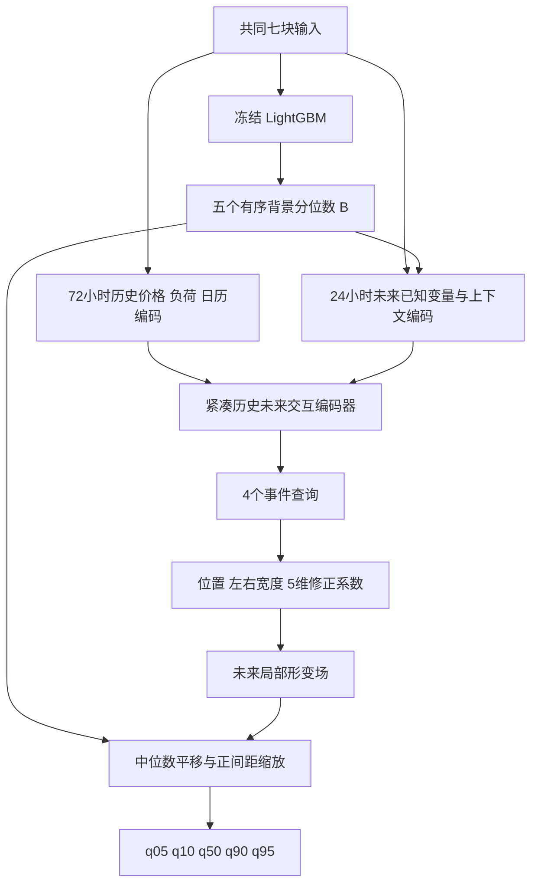

# Full v2 架构与实施方案

日期：2026-10-13。状态：研究设计草案，尚未实现或训练新 Full。当前结论仅使用 `aligned_baselines_20261012` 的公平比较结果、训练与选择集，以及下列一手文献。TimeXer 和 PriceFM 的补充实验不作为已经完成的性能证据。

推荐重建为 **Tree-Anchored Dual-Field Quantile Forecaster**，工程名称 `full_v2_tree_field`：**冻结 LightGBM 的条件背景分位数场，用一个紧凑的未来事件形变场，修正中位数位置和上下尾间距。** 双场发生在未来预测域，不再先重建历史、再通过多条重叠线性支路外推。

这是一种树与神经网络结合的分位数预测架构，不是纯神经端到端模型。它有意保留当前最强基线的能力，并将学习容量集中到跨预测步共享的条件修正。是否改善尖峰及总体性能，属于待检验假设。

## 设计依据

当前三个地区、三个 seed 的宏平均结果：LightGBM MAE 37.101、五分位数评分 QS 24.191；旧 Full MAE 48.464、QS 28.506。Full 相对 LightGBM 的 MAE 差距主要来自 0–300 普通价格区间。LightGBM 的 90% 区间总体覆盖为 85.10%；这个总体欠覆盖现象不能直接解释成尖峰条件下的欠覆盖。旧 Full 尖峰 q95 切片较好，但并未通过当前 168 小时块长的 Holm 检验，不能当作双场机制已成立的证据。

依据文件：[本轮结果](../logs/forecasting/aligned_baselines_20261012/results/report.md)、[分段误差贡献](../logs/forecasting/aligned_baselines_20261012/results/gap_contributions.csv)。

本次另外按不重复的交付小时统计训练与选择缓存，避免把同一个事件在 24 个 horizon 中重复计数。事件定义为连续小时价格严格大于 300，时间缺口打断事件：

| 地区 | 2015–2021 高价小时占比 | 训练期连续高价事件数 | 事件中位持续小时 | 一小时事件占比 | 2022H1 高价小时占比 |
| --- | ---: | ---: | ---: | ---: | ---: |
| NSW1 | 0.255% | 99 | 1 | 65.7% | 16.83% |
| QLD1 | 0.679% | 259 | 1 | 73.7% | 19.73% |
| TAS1 | 0.427% | 148 | 1 | 72.3% | 5.78% |

三地区合计 506 个训练期连续高价事件，并不等于 506 个统计独立事件：地区之间、相邻事件之间仍可能相关。2022H1 出现持续数十小时的高价阶段。固定的 300 阈值在不同年份描述的状态很不相同；新模块必须同时容纳短促尖峰和广域价格状态修正，不能强制所有高价都使用窄脉冲。

缓存覆盖的训练标签共有每地区 61,296 个独特小时，略少于整个日历训练期，原因是窗口边界。该统计不推断未被标签缓存覆盖时段。详细数值及生成脚本见 [设计证据](../logs/forecasting/full_v2_design_20261013/evidence.json) 和 [生成脚本](../logs/forecasting/full_v2_design_20261013/build_evidence.py)。

## 文献依据和创新边界

以下阅读范围包括正式论文页面、作者预印本、摘要与官方实现；对只核验摘要的论文明确标注，不将摘要推演成具体实现。

| 一手资料 | 对本设计的启发 | 不应由此声称 |
| --- | --- | --- |
| [LightGBM，NIPS 2017](https://papers.nips.cc/paper/2017/hash/6449f44a102fde848669bdd9eb6b76fa-Abstract.html) | 保留树的条件划分和非线性变量交互 | 树不能预测尖峰 |
| [DeepGBM，KDD 2019](https://www.microsoft.com/en-us/research/publication/deepgbm-a-deep-learning-framework-distilled-by-gbdt-for-online-prediction-tasks/)，[作者代码](https://github.com/motefly/DeepGBM) | 树知识与神经结构结合已有先例；首版无须蒸馏掉强背景 | 树加神经网络本身就是新方法 |
| [TimeXer，NeurIPS 2024](https://proceedings.neurips.cc/paper_files/paper/2024/hash/0113ef4642264adc2e6924a3cbbdf532-Abstract-Conference.html)，[官方代码](https://github.com/thuml/TimeXer) | 历史价格状态与外生变量应在表征阶段交互 | 时间注意力自动解决电价尖峰 |
| [TiDE，2023](https://arxiv.org/abs/2304.08424)，[官方实现](https://github.com/google-research/google-research/tree/master/tide) | 紧凑非线性编码可以处理动态协变量，不必采用巨大主干 | 简单增加 MLP 就能超过本任务 LightGBM |
| [TabM，ICLR 2025](https://arxiv.org/abs/2410.24210)，[官方代码](https://github.com/yandex-research/tabm) | 参数共享的 MLP 集成是纯神经背景的可行备选 | 当前首版已经使用 TabM 或已经验证其电价效果 |
| [Forecasting spikes in electricity prices，2012](https://www.sciencedirect.com/science/article/pii/S0169207011000550) | 澳大利亚半小时价格已有离散尖峰事件概率建模 | 事件核激活天然就是预测概率 |
| [澳洲 NEM 神经网络与极值分布，2014](https://doi.org/10.1016/j.enconman.2014.04.012) | 平滑部分与峰值尾部分开已有直接电价先例 | 背景加尖峰的宏观概念首次提出；此处核验出版摘要，未取得完整正文 |
| [Distributional neural networks for electricity price forecasting，2023](https://arxiv.org/abs/2207.02832) | 电价完整条件分布已有神经实现，偏态和尾部可以在输出层设计 | 德国日前结果可替代本任务实验 |
| [Spliced Binned-Pareto，2021](https://arxiv.org/abs/2106.10952)，[官方分布代码](https://ts.gluon.ai/dev/_modules/gluonts/torch/distributions/spliced_binned_pareto.html) | 主体与双侧尾部拼接有明确数学路线 | 五个离散分位数已唯一确定完整 CDF |
| [Gradient boosting for extreme quantile regression，2023](https://link.springer.com/article/10.1007/s10687-023-00473-x)，[gbex](https://github.com/JVelthoen/gbex/) | 条件尾部可由 boosting 与极值统计结合 | 本设计具有未经检验的 GPD 外推保证 |
| [Extremal Random Forests，JASA 2024](https://arxiv.org/abs/2201.12865)，[作者代码](https://github.com/nicolagnecco/erf) | 稀疏尾部估计需要控制自由度 | 更复杂尾部网络必然更好 |
| [EQRN，AOAS 2024](https://arxiv.org/abs/2208.07590)，[实现](https://opasche.github.io/EQRN/) | 中间分位数与条件极值估计可分阶段训练 | 洪水风险实验已证明本电价方案 |
| [电价尖峰持续性分析，2025](https://www.mdpi.com/1996-1073/18/19/5255) | 幅度和持续性是不同问题 | 其他市场持续时间可直接用于这里，或该研究就是24步预测器 |
| [SPQRx，Extremes 2026](https://link.springer.com/article/10.1007/s10687-026-00533-y) | 主体样条与 GP 上尾衔接已有近期工作 | 任意插值都具有极值外推保证 |
| [Dynamic Spike Calibration，IEEE 2026](https://ieeexplore.ieee.org/abstract/document/11457995/metrics) | 深度预测、极值与尖峰校准已有近期电价工作，需正面区分 | 已复现其全文算法或确认开放代码；此处只核验出版页摘要 |

研究主张应是：**保留强条件背景预测，通过历史状态与未来供需联合驱动的时间局部核，对未来分位数曲面作低自由度、有序且非对称的修正，研究它能否以较小常态代价改善尾部预测。**

候选贡献是基线锚定、跨 horizon 局部修正和有序分位数形变的共同设计。核函数、残差学习、非交叉输出和双场命名都不能单独充当创新。新 Full 有效后，还需要与同 OOF、相近容量的普通校正头比较，才能支持局部场约束的价值；本轮不启动旧 Full 消融。

## 主推架构

### 条件背景场

对每个地区和 seed，复用对应的冻结 LightGBM 模型、原输入顺序、既有训练与选择结果。定义

\[
B_{h,1:5}(x)=\operatorname{sort}\bigl(\mathrm{LightGBM}(x)_h\bigr),\qquad
\tau=(0.05,0.10,0.50,0.90,0.95).
\]

背景场包含原 LightGBM 已经学到的普通价格及尾部信息，并非只在 0–300 上拟合。冻结它的含义是保护已有预测，不是宣称它描述了真实市场的独立背景成分。这里的“场”是条件于输入的 horizon×quantile 映射；树不是连续时间 INR，不沿用原 CTF 的连续可微理论主张。

### 联合条件编码器

所有原有七块输入都接入，不再按照字段名把数据隔离到不同线性专家：

| 输入 | 接入方式 |
| --- | --- |
| 历史价格、负荷，72×2 | 与历史日历组成历史 token；保留完整轨迹 |
| 历史日历，72×10 | 同历史 token，明确实际使用 |
| 未来日历，24×10 | 未来 token |
| PASA 与预调度、互联线，24×11 | 未来 token |
| 净负荷，24×1 | 未来 token |
| 三个供给余量 shortfall，24×3 | 未来 token |
| 燃气原点上下文，1 | 广播至未来 token |
| 背景预测，24×5 | 派生内部特征；以 `(B - outer_train_price_mean) / outer_train_price_std` 中心化、缩放后加入未来 token |

首版建议隐藏维 64、4 个注意力头：一层未来 query 对历史 key/value 的交叉注意力，随后一层 24 小时未来 token 自注意力，各带小型残差前馈块。四个学习查询从未来状态中提取核参数。未来24小时的输入都是 origin 时已知的预测/日历，因此它们相互注意不需要屏蔽；未来实际价格绝不进入模型。

这是借鉴条件交互原则的新小型编码器，不称为直接复现 TimeXer。第一版不叠加 MoE、TabM 集成、Hawkes、GPD、独立校准专家或大模型预训练。参数数目在实现后实测，不预先虚构。

### 未来事件形变场

四个核是四个可定位基函数，不是四个已识别的真实事件。共享编码器同时决定中心、左右宽度和五个系数：

\[
\psi_k(h)=\exp\left[-\frac12\left(\frac{h-\mu_k}{\sigma_{k,L}\mathbf1_{h<\mu_k}+\sigma_{k,R}\mathbf1_{h\ge\mu_k}}\right)^2\right],
\]

\[
[a_h,v_{h,1},\ldots,v_{h,4}]=\sum_{k=1}^{4}\psi_k(h)c_k,
\qquad \delta_h=s_{\rm train}a_h,
\qquad r_{h,i}=3\tanh(v_{h,i}/3).
\]

其中 `s_train` 是本地区训练期固定价格标准差，避免把有价格单位的中位数修正和无量纲间距修正直接放进同一个正则。左右宽度独立，允许不对称的扩展和回落。宽度范围暂定 0.25–48 小时，中心允许在 0–24 小时，支持第一小时已经存在的修正、单小时尖峰及整段高价状态。

中心初始分散在 3、9、15、21 小时，左右宽度初始约 2、4 小时；只把系数输出层置零，不把全部位置和宽度初始化成相同值。零系数时，第一步几何和编码器梯度为零是正常现象；系数更新后它们应开始获得梯度，必须多步检查。

核中心解释为未来修正中心，不是实际事件起点；宽度解释为修正影响范围，不是校准的事件持续时间。核允许重叠及相互抵消，其分解不唯一。若大部分收益来自 24 小时宽核，研究结论应调整为条件分布校正，而不是声称尖峰定位已经成立。

### 单调输出

令相邻背景间距为 \(d_{h,i}=B_{h,i+1}-B_{h,i}\ge0\)。定义

\[
\widetilde d_{h,i}=d_{h,i}\exp(r_{h,i}),\qquad Q_{h,3}=B_{h,3}+\delta_h.
\]

由 q50 向上、向下累计正间距，得到全部五个分位数。这是对一个有序分位数向量的变换，不是把两个随机变量的分位数相加，也不是用事件概率乘幅度冒充中位数。

为了精确保留零修正状态，建议用 `expm1` 的等价增量实现。令 \(e_i=d_i\operatorname{expm1}(r_i)\)，省略 h：

\[
Q_1=B_1+\delta-e_2-e_1,\quad Q_2=B_2+\delta-e_2,\quad
Q_3=B_3+\delta,\quad Q_4=B_4+\delta+e_3,\quad
Q_5=B_5+\delta+e_3+e_4.
\]

在相同浮点表示下，零系数得到全零修正，五个输出与锚点逐元素相同。输出合成与导出使用 float64，神经编码器可用 float32；检查极端数值下的舍入误差，不能用隐藏的事后排序掩盖实现问题。

这带来三个结构性质：初始预测完全等于原基线；数学上不发生分位数交叉；上下尾可以分别收缩或扩张。训练后 MAE 不劣不是数学保证。

原始间距为零时，乘法修正仍为零，v1 不解除 ties。必须报告各地区/horizon 的 ties 比例，不悄悄给间距加 epsilon 再声称精确回退。如果 ties 严重限制输出，另立版本设计能够开启间距的非负残差参数化。

## 训练和模型选择

### 背景预测必须时间交叉拟合

不能用 LightGBM 对自身训练集的拟合结果训练二阶段修正器。初始设计使用四个 expanding folds：2015–2017 预测 2018、2015–2018 预测 2019、2015–2019 预测 2020、2015–2020 预测 2021。每个地区每个 seed 都保存相应 OOF 锚点。

每折必须满足：

1. 背景拟合和内层早停所读的所有标签时间，都严格早于被预测折的首个 origin；依据实际 24 小时标签终点隔离，不能只比较 origin 日期。
2. 内层早停在该折之前的尾段完成。内层拟合标签终点也必须严格早于内层选择集首个 origin，避免相邻 24 小时标签重叠。选择树迭代数后，可按预先固定程序在整个可用 prefix 重拟合；2022 不参与 OOF 树迭代数选择。
3. 内层拟合时，缩放、裁剪分位点、shortfall 阈值等学习型预处理仅用 inner-fit 段；选好轮数后，最终 prefix-refit 才重拟合整个可用 prefix 的统计量。不能直接声称使用全 2015–2021 统计量生成的缓存就是完全前推的 OOF。复用预处理代码和特征定义，重新拟合折内统计量。
4. OOF 预测逆变换回原始价格，与外层共同缓存通过地区、origin 和 target timestamps 严格 join；二阶段使用外层共同七块输入及 OOF 锚点。不能按数组行号盲拼接。
5. OOF 标签仍属于外层训练期；事件网络实际使用的训练年份是 2018–2021，不能宣称它也使用了全部七年 OOF。记录这一子集的真实事件数。

最终选择/校准/测试时，使用原 2015–2021 完整训练期对应的冻结 LightGBM。OOF 背景与全量背景的精度和间距分布可能不同，需在 2022 诊断；不能宣称交叉拟合已消除所有分布偏移。

四折×三地区×三 seed 共 36 个额外背景训练任务，每个包含当前 24 horizon×5 quantile 的树训练。九个最终背景可复用现有模型，但其原训练成本、36 个 OOF 任务与事件网络训练成本都应列入模型总账。内部时间交叉拟合服务于 stacking 训练，主测试仍是固定静态训练，不是季度滚动重训评估。

### 一个主预测目标

首版目标为原有五分位数的平均 pinball，加很小的系数组正则：

\[
\mathcal L=\frac{1}{NH5}\sum_{n,h,j}\rho_{\tau_j}\left(\frac{y_{n,h}-Q_{n,h,j}}{s_{\rm train}}\right)
+10^{-4}\frac{1}{NK}\sum_{n,k}\left(\sqrt{\lVert c_{n,k}\rVert_2^2+\epsilon^2}-\epsilon\right).
\]

这里 epsilon 只用于正则范数的可微性，不加到预测间距。所有预测水平仍按原始价格评分。固定正尺度缩放不改变单地区 pinball 的最优解，但需记录其对正则相对强度的影响。

取消旧 Full 的历史重建、单独点预测 MSE、硬事件稀疏项、额外尾部加权和多层预测后排序。首版直接让最终预测误差决定哪里值得修正，不预设所有上尾都必须加宽。

初始配置：batch 256，最多 100 epoch，patience 15，AdamW learning rate 3e-4，weight decay 1e-4，dropout 0.1。它是起始设计，不是已验证最优超参；如后续调参，完整记录候选和预算。

### 冻结验证选择规则

2022H1 用于 checkpoint 选择，2022H2 暂不启用额外校准层，2023–2024 仅作回顾性最终比较。当前测试已反复查看，不重新称为盲测。

建议在训练前固定一个工程准入条件：候选 checkpoint 的选择集总体 MAE 与 0–300 切片 MAE，都不超过对应 LightGBM 的 1.01 倍；在合格候选中选共同五分位数 pinball 最低者。1% 是提议的容忍边界，不是统计学上已证明的非劣标准。这个约束比原基线的单指标选点多，应在报告中披露。

把 epoch 0 的零修正锚点纳入候选。如果最佳仍是 epoch 0，记录该格未获益，不能通过换 seed、换地区或测试后改规则制造新 Full 优势。每个地区专用模型遵守同一规则；每格是否实际启用非零修正必须公开。不额外搜索一个测试后选择的混合权重。

## 实施文件与顺序

本文件和配套 YAML 是设计产物，以下代码均为待实现项。旧 `full` 类和本轮冻结基线保持作为可重现对照；新模型使用独立名称。

| 顺序 | 文件或模块 | 具体工作与验收 |
| --- | --- | --- |
| 1 | `forecasting/tree_anchor.py` | 加载冻结 LGB，核对特征顺序、树迭代数、seed 和模型哈希；输出与保存的基线预测一致 |
| 2 | `forecasting/temporal_crossfit.py` | 四折前推、内层早停、折内预处理、标签终点隔离及 OOF manifest；保存样本 ID，不创建新的测试样本 |
| 3 | `forecasting/full_v2.py` | 小型联合编码器、四核参数解码、零系数初始化；独立于旧 Full 的历史分解代码 |
| 4 | `forecasting/quantile_transport.py` | 中位数平移、四间距缩放、float64 合成与有限性检查；原 ties 明确保留 |
| 5 | `forecasting/full_v2_training.py` | OOF 锚点训练、简单 pinball、epoch 0 候选、验证准入、恢复 checkpoint 和锚点捆绑 |
| 6 | `forecasting/aligned_runner.py` 与独立新配置 | 注册 `full_v2_tree_field`，复用共同输入与评分，不走旧 Full loss；使用单独冻结运行目录 |
| 7 | `forecasting/analysis/full_v2_report.py` | 保存背景及最终预测、整体形变、核范围、正则与饱和信息；同 origin 配对比较 |
| 8 | `tests/test_full_v2.py`、`test_quantile_transport.py`、`test_temporal_crossfit.py` | 恒等、单调、梯度、样本 join、时间边界、无标签输入、保存重载等机制检查 |

配套 [设计配置](../configs/research/full_v2_20261013.draft.yaml) 明确标记不可直接启动实验。实施完成后冻结真实运行日期、新源码哈希、原锚点哈希和 OOF 哈希，输出到新的 `outputs/forecasting/full_v2_<freeze_date>/`。

第一轮顺序为：实现及数学检查 → 单地区训练/选择集 smoke → 冻结共同配置与选择规则 → 三地区三 seed 的新 Full。暂不重跑旧 Full 的消融，不在新模型尚未成立时同时启动多个复杂结构。

## 数学和实现验收

1. 零系数时，全部五分位数与同浮点表示的冻结 LightGBM 逐元素一致；每格都验证，而不是只看平均 MAE 接近。
2. 随机输入、原始 ties、负价格和极端有限系数下，有序且有限；记录 float64 舍入容差。
3. 正中位数修正平移所有分位数；单个正 log-gap 修正只扩大该间距及其外侧输出，符号方向正确。
4. 第一步系数头有梯度，数步后中心、左右宽度、查询、历史与未来编码器均有有限梯度；确认冻结树完全不更新。
5. 输出合成层在锚点、位置修正及固定尺度同步作正仿射变换时保持一致；内部锚点特征采用明确的均值中心化与标准差缩放。这个代数性质不声称整个重新训练流程严格仿射等变；原始输出不被隐藏裁剪或加 epsilon。
6. 检查单小时修正、h=1/h=24 边界、正在持续的高价期及全时域修正的表达能力。
7. 标签污染检查：修改未来真实标签不改变前向输出；七块输入分别有可检测的影响路径。
8. OOF 训练标签终点、内层早停和学习型预处理统计均不越过折预测 origin；join 后 origin/target hash 一致。
9. 保存重载包含背景与事件模型，重复预测一致；零间距比例、核宽度、系数大小、间距缩放饱和比例纳入日志。

## 如何判断尖峰故事是否成立

主表继续报告共同 q50 MAE、RMSE 和五分位数 QS，不改变评分口径。所有九格完整后才能评价新 Full；同时对比 LightGBM、XGBoost 和届时完成的 TimeXer、PriceFM。

预先固定的补充评估应包括：全样本 q05/q95 pinball、上下尾覆盖与区间宽度、按 horizon 的表现、普通价格切片和高价/负价切片。只看真实高价时的误差不能惩罚平时误报；必须同时报告全样本尾部分位数损失。阈值越界报警可用 `q95 > 300` 等固定规则计算查准率、召回率，但不能把它当作直接估计的事件概率。

由于首版只有五个分位数，不从任意插值虚构精确 Brier 概率、q99 或完整轨迹风险。要报告这些，需要另行定义合法 CDF/事件过程，并让基线具备可比输出。

可解释报告首先使用具有确定含义的整体量：`Q50-B50`、`Q95-B95`、`Q05-B05`、90% 区间宽度变化、四个 log-gap 变化。核位置和范围是内部修正结构描述，不是因果归因或数据贡献百分比。对所有验证 origin 统计局部/广域修正比例，不仅挑几个漂亮尖峰作图。

若新 Full 仅靠扩大区间获得覆盖，pinball 会给出相应代价；若只靠宽核改善中心偏差，结论应如实限定。若维持普通价格水平并改善全样本尾部 proper score，才具备继续研究事件场的依据。最终统计仍需配对时间块方法，并将重叠 origin 和地区相关性纳入考虑。

## 没有选择的路线

| 路线 | 本轮暂缓原因 | 何时值得采用 |
| --- | --- | --- |
| 旧 Full 继续加层或专家 | 保留了弱背景、重叠残差和历史事件重建问题 | 不作为本轮主线 |
| LightGBM 加无约束 24×5 MLP 修正 | 容易实现但不能体现时间局部结构 | 新 Full 有效后作为同预算机制对照 |
| 主体分布加正负事件 Markov/GPD | 概率解释较完整，但五个树分位数不足以给出唯一 CDF；训练事件稀少，阈值稳定性也未建立 | 需要事件概率、持续性概率或 q99 以上风险时，作为独立扩展 |
| TabM/TiDE 原理的纯神经双场 | 结构可以统一，但没有理由预设其日常价格能力已达到 LightGBM | 混合方案成立后，再替换背景模块并重新验证 |

如果最终要做事件 CDF，必须区分事件发生、条件幅度及状态持续性，用合法 CDF 合成后求逆分位数，不能用 `q50_background + probability × amplitude`。事件概率低于 50% 时，合理中位数本来可能不跳到尖峰；因此论文应研究尖峰风险与分位数预测能力，而不承诺每次实际尖峰都被 q50 精确追踪。

本方案的价值在于给双场一个可实现、可检验的预测职责。模型名称和论文叙事应跟随最终证据；目前不承诺新的 SOTA，也不声称旧双场已经证明尖峰优势。
