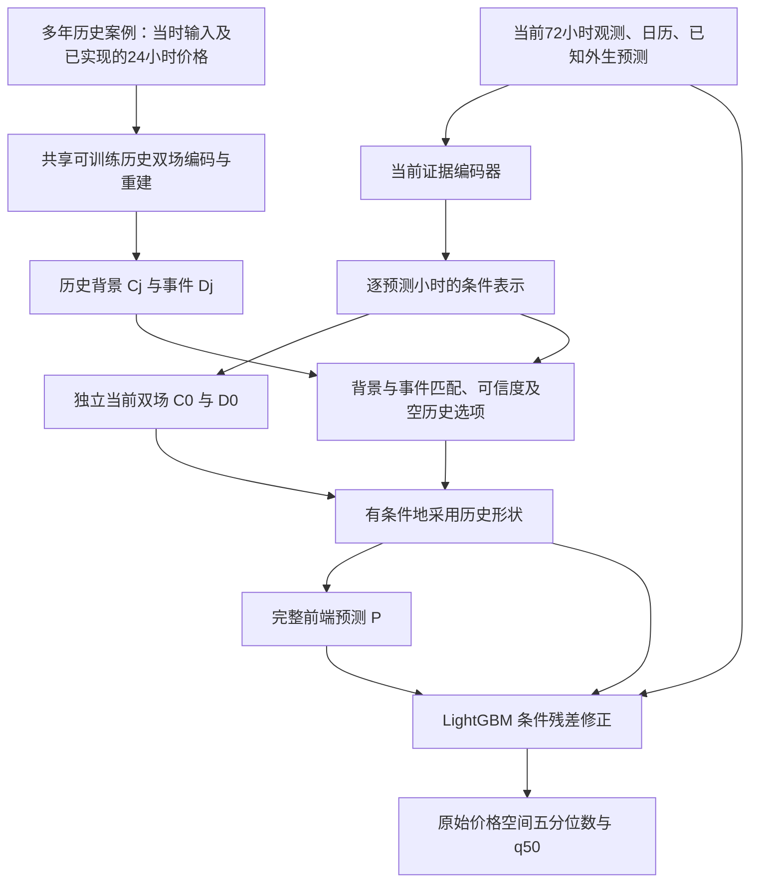

# Full V4：当前证据驱动的可训练双场、历史可信度选择与残差修正

日期：2026-10-14。工作分支：`research/full-v4-trainable-dual-field-20261014`。

状态：**已实现并通过正式训练前验证，进入全量实验阶段**。本文是实现与审查的依据；所有 V4 性能判断均为待验证假设。V3 代码、结果和原始基线保持原样。正式运行的最终配置与代码以输出目录中的冻结副本为准。

## 1. 研究问题与证据边界

希望解决的问题是：当前 72 小时状态及预测时刻已知的未来市场条件，如何决定历史价格形状是否适用；适用时如何分别迁移背景与事件，不适用时如何独立产生新的趋势和尖峰预测；最后如何利用 LightGBM 修正仍然存在的条件偏差。

拟验证的论文主张是：**把历史双场作为可选择的形状参照，由当前市场证据控制其采用程度，再用树模型修正条件误差。** “历史检索”“门控”“残差树”本身不作为已证明的新颖贡献；需要进一步文献核对和机制证据。

已完成的 V3 提供以下事实（NSW1、QLD1、TAS1，seed 2026，测试 2023–2024）：

| 方法 | 地区宏平均 MAE |
|---|---:|
| 原 LightGBM | 37.0890 |
| V3 历史特征 LightGBM | 37.5934 |
| V3 共享检索双场 + 残差树 | 44.4362 |
| V3 条件检索双场 + 残差树 | 46.4241 |

条件检索版相对历史特征版增加 8.8306 MAE，其中约 88.48% 的差额来自真实价格 0–300 区间。历史先验相对近期水平偏移超过 300 的样本占约 1.30%，贡献约 54.92% 的差额。这些分组存在交叉，不能相加解释机制。

V3 有四项明确局限：

1. 每条历史曲线独立做固定 DCT/高斯基分解，没有跨样本学习历史表示。
2. 有候选时检索权重必须归一为 1；相对最相似不代表绝对可信。
3. 当前证据没有独立完整的未来双场预测路径；无历史时退回最近价格中位数。
4. 历史先验被强制相加，残差树输入未显式包含完整先验及原始近期水平。极端错误先验可能超出训练范围，有限叶节点的树不能保证抵消。

这些事实支持重新设计，不能证明历史永远无效，也不能证明 V4 必然优于 LightGBM。V3 在 2022 下半年曾有收益，说明应检查适用条件和时期差异。旧双场拟合历史的能力也不等于预测未知尖峰的能力。

证据文件：`logs/forecasting/full_v3_20261013/{report.md,results.csv,summary.json}`、`logs/forecasting/full_v3_diagnosis_20261014/{summary.json,diagnosis.json}`。

## 2. 不变的任务、数据与评分

- 每小时一个预测 origin，使用此前 72 小时观测，预测从 origin 开始的连续 24 小时，即缓存定义的 `[t, …, t+23h]`。这是逐小时滚动多步预测，不是固定时点日前预测。
- 地区分别训练：NSW1、QLD1、TAS1。第一轮 seed 2026；有稳定验证证据后再扩展 2027、2028，不事后挑 seed 或地区。
- 训练 2015–2021；2022 上半年用于模型选择；2022 下半年用于诊断，不拟合校准；2023–2024 用于冻结后的回顾性评价。所有这些时期已经查看过，不称盲测。
- 复用共同缓存，保持预测样本、标签、时间戳、原始七块输入及其公共预处理一致。保留全部查询，不能因为历史缺失或难预测而删样本。
- 原始价格空间统一评分，最终点预测仍是共同五分位数输出排序后的 q50。使用相同 MAE、RMSE、QS proxy、覆盖率实现；五点 QS proxy 不称为精确 CRPS。
- 历史 1/2/3 年同季曲线属于方法增加的信息。原基线输入不变；与原 LightGBM 的比较不能称为“所有有效信息完全相同”的结构消融。
- 不新增新闻、天气或情绪数据，不把供需压力或价格场直接称为市场情绪。新增数据需要独立的数据来源、发布时间与对照设计。

| 当前输入 | 形状（不含 batch） | 进入模块 |
|---|---|---|
| `history_values` | 72 × 2，价格/负荷 | 当前序列编码器、匹配、最终树 |
| `history_calendar` | 72 × 10 | 当前序列编码器、最终树 |
| `future_calendar` | 24 × 10 | 未来条件编码器、匹配、最终树 |
| `origin_context` | 1，燃气上下文 | 未来条件编码器、匹配、最终树 |
| `future_exogenous` | 24 × 11 | 未来条件编码器、匹配、最终树 |
| `ctf_exogenous` | 24 × 1 | 未来条件编码器、匹配、最终树 |
| `quantile_exogenous` | 24 × 3 | 未来条件编码器、匹配、最终树 |

以上维度须在实现时由缓存 schema 断言确认，列名按 manifest 映射，禁止仅凭位置猜含义。缺失覆盖标记也进入编码器，不当作普通物理量标准化后混淆其语义。

## 3. 总体架构与符号

记当前七块输入为 X_t，当前价格水平 L_t 为此前 24 小时价格中位数。历史案例 j 包含 X_j 与已公布的后续 24 小时价格 Y_j。C 表示背景场，D 表示带符号的局部事件场。

四个主要模块依次为：A 历史双场表示，B 当前证据及独立双场预测，C 匹配与历史采用，D LightGBM 残差修正。A/B/C 共同构成可单独评估的完整预测器，D 的增益必须另外验证。

## 4. 模块 A：跨样本学习的历史双场

### 4.1 案例与训练任务

训练案例遍历训练期合规 origins，不局限于查询时的 49 个候选。每个案例包含：此前 72 小时观测、当时可获得的日历和外生预测、后续已实现的 24 小时价格。历史编码器允许读取这个已实现的 Y_j；当前查询编码器绝不能读取未知 Y_t。

采用历史后验编码器 `E_hist(X_j, Y_j)` 得到低维 z_j，再由共享解码器重建：

\[
z_j=E_{hist}(X_j,Y_j),\qquad \widehat Y_j=C_\theta(\tau,z_j)+D_\phi(\tau,z_j).
\]

这里的共享是跨训练案例共享参数；各地区首轮仍分别训练。历史编码器不是把 24 个价格逐点直接复制到输出。采用低维瓶颈和随机掩蔽重建，验证在未参与拟合的历史曲线上的表示能力。

### 4.2 首轮可实现的场参数化

- 背景 C：固定平滑三次 B 样条时间基（首轮 6 个基），系数由可训练 decoder 从 z 产生。固定时间基不等于 V3 的独立拟合：V4 编码器/系数映射跨案例共享并受预测损失训练。
- 事件 D：4 个带符号局部高斯原子，幅度、中心、宽度由 decoder 生成；中心限制在预测窗口内，宽度限制为 0.5–6 小时。首轮不加入振荡频率，减少可辨识性和优化负担。
- 历史与当前预测共享时间基及场 decoder；历史后验编码器与当前条件编码器分开，防止把需要未来价格的后验路径误用到预测。
- 背景使用二阶差分平滑约束，事件使用幅度稀疏约束；所有场输出都有明确的原始价格单位逆变换。

模型可以分配趋势和事件，但 C/D 的分解不唯一。平滑与局部约束是表示假设，不是物理或因果识别；不能仅凭重建误差小就证明两场有效。

### 4.3 历史水平对齐

历史重建输出为原始单位 C_j、D_j。迁移前使用：

\[
\bar C_{t,j,h}=L_t+(C_{j,h}-L_j),\qquad \bar D_{t,j,h}=D_{j,h}.
\]

首轮不额外学习自由放大的价格倍率或时间扭曲，避免门控、尺度、位置同时变化导致难以归因。错误事件幅度应被当前条件拒绝，而不是默认强制迁移。若以后引入倍率，需要单独版本和对应对照。

## 5. 模块 B：当前证据处理与独立预测

### 5.1 序列与未来条件

72 小时价格、负荷及历史日历进入小型 TCN，保留时间顺序。每个未来小时以未来日历、燃气上下文和该小时外生预测形成 query，关注 72 小时状态，生成 z_{t,h}。

外生变量先按语义分组编码，再做非线性交互：需求/净负荷，供应/备用/缺口，互联线/进出口能力，预调度价格，日历/燃料，以及覆盖与缺失质量。列归属、重复信息及单位写入 schema；不能把任何一组只接到最后的线性 adapter 就宣称它已充分参与双场预测。

首轮建议宽度 64、3 层 TCN（kernel 3，dilation 1/2/4）、4 头 attention、dropout 0.1。它们是待 smoke 确认的初始预算，不是已选出的最优超参。

### 5.2 当前双场输出

首轮把 24 个条件 token 按固定 horizon 顺序拼接，经小型 MLP 压缩到 32 维 z_t，再由共享 decoder 一次输出整条曲线的样条系数和事件原子参数；不让每个小时独立生成互不一致的 24 小时事件。历史编码器同样输出 32 维 z_j。逐小时 token 仍保留给匹配网络。

当前条件表示经过 decoder 产生 C^0_t、D^0_t，组成当前证据预测：

\[
P^0_{t,h}=C^0_{t,h}+D^0_{t,h}.
\]

即使历史候选全部平坦、没有尖峰或完全缺失，D^0 也能根据当前供需/预调度证据产生新的正负事件形状。整个模型不会被限制为历史事件的加权平均。

C^0、D^0 是共同构成一个点预测的表示分量，不能分别称为条件中位数后再假设二者相加等于整体中位数。主预测损失直接施加于 P^0 或融合后的 P。

首轮不另加事件概率头。若后续增加 `Pr(y>300)` 或负价概率，需专门的二分类监督和校准评价；概率不能直接当作 q50 的事件幅度。

## 6. 模块 C：匹配、可信度与允许拒绝历史

### 6.1 候选和因果边界

初版沿用 V3 候选枚举：1/2/3 年滞后各 ±7 天同小时，以及 7/14/21/28 天滞后，最多 49 个。时间使用 Australia/Brisbane；闰日、缺口、重复及迟发处理沿用已有测试语义。

每个候选的 72 小时历史、24 小时结果及所需档案在查询时必须可用，候选结果窗口不能与查询未来重叠。历史库可随真实已公布的记录增长，但模型参数和归一化统计在评估期间不更新。原数据 `archive_timestamp_proxies_only` 限制继续标注，不能称已完成真实发布回放审计。

### 6.2 相似性和采用度分别表达

背景和事件分别计算候选打分。可用信号包括当前/候选条件表示、已观测 72 小时的水平及形状差异、未来市场条件差异、候选年龄、覆盖、历史重建误差和候选之间的分歧。没有当前未来真实误差这个输入。

首轮对每个分支使用包含一个 **null（无历史）候选** 的 sparsemax 权重，显式支持某些候选权重为零。null 的分数由当前条件及候选质量摘要产生；它的 value 为零修正。不得使用普通 softmax 却声称能严格拒绝全部历史。

设分支 b∈{C,D} 的真实候选权重为 a^b_j、null 权重为 a^b_null，总和为 1。定义采用度 g_b=1−a^b_null，则：

\[
C^*_{t,h}=C^0_{t,h}+\sum_j a^C_{t,j,h}(\bar C_{t,j,h}-C^0_{t,h}),
\]
\[
D^*_{t,h}=D^0_{t,h}+\sum_j a^D_{t,j,h}(\bar D_{t,j,h}-D^0_{t,h}),\qquad P=C^*+D^*.
\]

这相当于在当前场与可信历史场之间凸组合。两路均选择 null 时严格有 P=P^0；可以只采用历史背景而拒绝历史事件。无候选时强制两路 null 权重为 1，保留查询样本。

为缓解逐小时切换导致的曲线断裂，打分网络联合处理 24 小时，对相邻小时权重施加弱总变差约束；不能强平滑到抹去真实事件起始。评价时报告权重变化和轨迹跳变，不预设该约束必然改善。

### 6.3 不允许历史绕过拒绝机制

定义实际采用的修正 ΔC=C^*−C^0、ΔD=D^*−D^0。最终树可见当前预测、P、ΔC/ΔD、gC/gD，但不直接见未门控的历史原始曲线、候选幅度或历史后验 embedding。

首轮不把独立的候选质量/分歧摘要送入树；它们只用于上游决策。这样在强制全 null 的干预下，所有历史通道归零，最终输出也应与历史库内容无关。树仍可利用 g 判断前端是否采用了历史，但 g 不是概率校准后的可信度，也不是贡献百分比。

训练中随机整条删除历史库（memory dropout），同时给 P^0 独立监督，防止当前路径退化。具体采用率由预测损失学习，不用测试集手工设置“尖峰时开、普通时关”。

## 7. 模块 D：LightGBM 解决什么问题

树的角色是修正完整前端预测 P 尚未解释的条件误差，例如特定备用容量区间的系统性幅度偏差、进口能力与负荷的阈值交互、不同 horizon 的偏置。其优势是表格特征的阈值划分、非线性交互及逐步拟合残差；不能将其描述为对错误先验无上限的纠错器。

树输入 Z 按固定 schema 拼接：原始七块输入，以及 24 小时 P、P^0、C^0、D^0、ΔC、ΔD、gC、gD 和当前原始水平 L_t。所有浮点特征使用已登记的尺度；不传入各 OOF fold 中可能任意旋转的 latent embedding。P 与 L 必须显式包含。

对每个 horizon 及 q∈{.05,.1,.5,.9,.95}：

\[
u=(Y-P)/\sigma,\qquad \widehat Q_q(Y\mid Z)=P+\sigma\widehat Q_q(u\mid Z).
\]

σ 来自相应训练范围且严格为正。不额外加价格均值，P 只加一次。分位数平移关系在给定确定 P 的条件下成立，但不保证有限深度树能学到理想修正。

最终五分位数排序与共同评分保持一致，另外记录排序前交叉率。前端 P 的 MAE 单独报告；不要把 P 自动等同于最终排序后的 q50。

沿用原树预算：每地区 120 个 booster；最大 2000 轮、patience 50、lr .05、31 leaves、min_child_samples 50、subsample/colsample .8；每个 horizon 五分位数按共同验证 pinball 选择轮数。新神经网络及 OOF 训练开销另行报告，不能称整体计算预算与原树完全相同。

## 8. 学习目标与训练顺序

### 8.1 前端目标

在训练范围的正仿射价格尺度上，初始目标为：

\[
\mathcal L=\rho_{.5}(Y-P)+\lambda_0\rho_{.5}(Y-P^0)
+\lambda_R\|Y_j-C_j-D_j\|_1
+\lambda_C\|\Delta_h^2C\|_2^2
+\lambda_D\|A_D\|_1
+\lambda_G\|\Delta_h a\|_1.
\]

各项按元素取均值后加权；A_D 为事件原子幅度，平滑/稀疏同时覆盖当前和历史路径。ρ_.5 与 MAE 仅相差常数。首轮建议 λ0=.2、λR=.2、λC=.01、λD=.001、λG=.001，memory dropout=.2；冻结前记录各项量级与梯度，避免名义小权重实际支配目标。

原始价格空间评分不变；不引入 asinh，不以 MSE 默认替代 q50 目标。重建和场约束只是辅助学习，历史重建好不构成预测有效的证据。

### 8.2 三阶段

1. 历史双场预训练：训练范围内的合规案例进行重建/掩蔽重建，建议最多 20 epoch。
2. 前端联合训练：当前编码器、共享 decoder、历史编码器及匹配网络共同训练，建议 AdamW、lr 1e-3、weight decay 1e-4、batch 128、最多 100 epoch、patience 10，以验证 P 的 MAE 选择。联合训练中的历史表示必须随参数更新重算，不能使用过期缓存仍声称端到端学习。
3. 冻结前端，生成按时间的样本外特征，再训练残差树。树不可微，不声称四模块联合反向传播。

上列数值是首轮实施建议。正式运行前形成唯一配置并冻结；技术 smoke 仅验证数值/内存/接口，不能通过反复查看测试结果改这些参数。

## 9. 时间 OOF、预处理与堆叠泄漏

残差树不使用“在同一条标签上训练过的前端”所给出的拟合残差。首轮按以下扩展窗口生成训练特征：

| Fold | 前端可拟合年份 | 为树生成样本外预测的年份 |
|---|---|---|
| F1 | 2015–2017 | 2018–2019 |
| F2 | 2015–2019 | 2020 |
| F3 | 2015–2020 | 2021 |

每 fold 的早停只使用其前缀内最后 6 个月。选择轮数时，历史预训练、前端拟合和统计量均限定在该内部验证段之前，不能先重建内部验证标签再声称它是独立早停集；确定轮数后在完整前缀重训固定轮数。内外两层边界均按实际 target/availability 判断，前缀训练样本的完整 24 小时标签必须早于留出段起点；不只按 origin 年份粗切。

所有可学习部件、统计量、门控、历史预训练均只使用该 fold 前缀。OOF 期间可检索更早已公布的 fold 内案例，但不更新任何参数。这与正式动态历史库的规则一致。

共同缓存使用完整训练期的标准化，不能不经处理就声称严格的前缀归一化。实现应依据保存的仿射参数恢复数值，在前端内部按前缀重新拟合统计量；原始七块缓存及其哈希保持不变。若某种预处理不可逆或依赖后续数据，必须从合规原始档案重建该内部路径并记录，不能忽略泄漏。

OOF 树特征恢复为共同定义的物理单位；残差树只在 OOF 覆盖的 2018–2021 行上拟合自身尺度。另训练使用完全相同这些行的直接 LightGBM 对照，以区分“训练范围变化”和“前端/残差收益”。原 2015–2021 LightGBM 仍保留作主参考。

最终前端使用 2015–2021 拟合、2022 上半年选择，随后为验证/测试生成特征；树只拟合训练期 OOF 行，用 2022 上半年选择轮数。记录 OOF 与最终前端之间的 P、残差及采用率分布差异；重训带来的分布偏移是堆叠限制，不是 OOF 自动解决的问题。

## 10. 对照顺序与结论范围

第一阶段完成技术 smoke 和验证期分析，确认普通价格、尖峰、历史缺失三类行为合理后才冻结正式矩阵。首轮三地区一个 seed，核心五项新运行如下；不强行把所有对照称为单因素消融。

| ID | 配置 | 回答的问题 |
|---|---|---|
| `v4_lgb_oof_rows` | 原七块输入，直接树，仅 OOF 相同行 | 相同树训练范围的参照 |
| `v4_current_residual` | 当前证据双场，始终无历史，OOF 残差树 | 当前双场加树是否本身有效 |
| `v4_full` | 可训练历史双场 + 当前证据 + null 选择 + OOF 残差树 | 预先指定的完整 V4 |
| `v4_forced_history` | 相同架构但有候选时禁用 null；空库仍回退 | 拒绝历史的机制价值 |
| `v4_direct_tree` | 使用 Full 的同一套 OOF Z 特征，直接拟合 Y | 显式残差目标相对直接树是否必要 |

原 LightGBM、V3 历史特征树及 V3 最终版作为已冻结参考附列。`v4_full` 的前端 P 自动保存并评分，作为“加树之前”的点预测对照，不伪装成具有五分位数输出的完整概率模型。`v4_direct_tree` 复用 Full 特征时不得重新拟合前端或改变输入 schema。

`v4_current_residual` 和 `v4_full` 的区别包含历史信息及相应训练路径；`v4_forced_history` 必须重新训练，不能只推理时把 g 改成 1 后称为公平消融。强制 null/候选打乱等推理干预另列机制诊断。

若核心结果支持完整路线，再开展：可训练双场 vs 固定双场/容量匹配单场，共享匹配 vs 分别匹配，有无外生交互，有无 memory dropout。第一轮不能证明双场分解本身优于所有其它表示。

三 seed 稳健性与统计检验放在后续冻结阶段；按时间块配对，不把重叠 origin×horizon 当作独立样本。若继续使用已反复查看的时期，仍只能给回顾性证据，不用显著性检验恢复“盲测”资格。

## 11. 必须产出的机制诊断

- 整体及各地区 MAE、RMSE、QS proxy；0–300、>300、负价分组误差和偏差；固定阈值的误报/召回。高价误差好不等于整体更优。
- 当前路径 P^0、融合 P、最终 q50 分别评分，分清历史与树在哪些条件下改善或恶化。
- gC/gD、null 率、候选权重变化、候选年龄/质量；按当前已知供需条件分组，不用未来标签建立部署规则。
- 普通当前价格条件下的错误历史尖峰采用；当前有事件但历史无事件时 D^0 是否能预测；完全空库行为。
- 展示 C^0、D^0、ΔC、ΔD、树修正及最终预测的曲线。加法数值分量可直接记录，但它们不是因果贡献比例。
- 受控删除历史、拒绝事件场、移除外生组等干预下的性能变化；注明重新训练消融与推理干预的区别，避免把门控权重当作解释证明。
- OOF/最终前端分布偏移、先验超训练范围比例、残差大小、量纲、分位数交叉、普通价格上的极端误报。

推进标准：先看验证期完整三地区结果，当前路径必须可用、历史不能靠少数错误大尖峰破坏普通区间、树必须相对同数据范围对照有可解释的增益。若验证失败，先定位模块并修订版本；不要运行完测试后挑胜出的零件重命名为 Full。

## 12. 工程文件与接口计划

实现文件与职责如下：

| 文件 | 职责 |
|---|---|
| `forecasting/full_v4/schema.py` | 七块输入、树特征顺序、单位及输出契约 |
| `forecasting/full_v4/data.py` | 从原始档案按训练前缀重建内部预处理、设备输入库 |
| `forecasting/full_v4/memory.py` | 候选、as-of 审计；复用 V3 规则而非静默改变 |
| `forecasting/full_v4/fields.py` | 可训练历史编码、共享背景/事件 decoder |
| `forecasting/full_v4/evidence.py` | 当前 TCN、未来条件分组、交互及当前双场 |
| `forecasting/full_v4/retrieval.py` | 分支打分、null sparsemax、融合和审计 |
| `forecasting/full_v4/frontend.py` | A/B/C 组合、损失及训练/预测接口 |
| `forecasting/full_v4/training.py` | 历史掩蔽预训练、联合训练、早停及物理单位预测 |
| `forecasting/full_v4/crossfit.py` | 时间 OOF、边界清除、fold 统计和模型身份 |
| `forecasting/full_v4/model.py` | 树 schema、残差/直接目标、逆变换与重载 |
| `forecasting/full_v4/experiment.py` | 冻结快照、调度、恢复与完整矩阵 |
| `forecasting/full_v4/report.py` | 共同评分、完整性与机制报告 |
| `forecasting/full_v4/{README.md,source.json}` | 本地实现与所调用官方库来源 |
| `configs/full_v4/experiment.yaml` | 冻结后的唯一实验配置 |

前端 `predict` 返回 `[B,24]` 的 P/P0/C0/D0/ΔC/ΔD/gC/gD，以及候选索引、mask、权重、最大可用时间；训练接口单独接收标签。历史后验重建接口只接收已核验可用的案例。树输出 `[B,24,5]`，携带 origin/target 时间与真实 input hash。

正式目录在启动当天确定为 `outputs/forecasting/full_v4_<YYYYMMDD>`，包含冻结 `source/`、`design.md`、配置、依赖版本、样本/输入/派生特征哈希、OOF folds、模型、预测、审计及报告。smoke 使用独立目录，不能进入正式表。最终汇总归档至 `logs/forecasting/`，大型模型仍保留在忽略的输出目录。

## 13. 实现顺序与审查验收

1. 锁定 schema、单位和时间 OOF 清单；复用共同评分；加入历史污染与 fold 边界测试。
2. 实现共享场和当前证据路径，验证单独 P^0 的训练、预测、保存重载及梯度。
3. 实现 null 匹配、融合和历史缺失；验证联合训练确实更新历史表示。
4. 实现 OOF 产物和残差树，先跑单地区极小样本 smoke；独立核对公式、原始单位、样本对齐。
5. 固定三地区验证矩阵、资源预算和配置；审查通过后再运行正式五项 × 三地区 × 一个 seed。

必须通过的测试和审查：

- 修改查询未来标签、不合规未来档案，不得改变查询输入或预测；允许已经公布的过去价格影响后续查询。
- 修改某 OOF fold 未来标签，不得影响该 fold 的前端参数、前缀统计量和更早查询预测；标签只在监督/事后评价路径读取。
- 所有候选无效时 gC=gD=0 且 P=P0；强制 null 后替换任意历史曲线，完整树预测也不变。
- 仅拒绝事件历史仍能保留背景；历史全平坦时当前 D0 具有非零表达能力。后者是结构测试，不冒充预测有效实验。
- 原始单位公式逐项复算，残差解码只加一次 P；正负价格、常数曲线和极端值均有限；排序与 q50 定义一致。
- 掩蔽候选在 softmax/sparsemax 前处理，不能通过 NaN、padding 或默认索引读取污染有效特征。
- 跨 fold 树特征有相同含义/单位，禁用任意旋转的 embedding；验证保存重载、hash 篡改拒绝和旧缓存失效。
- 完整三地区矩阵才形成完整排名；失败格、时间成本、参数量、OOF 样本损失及内存峰值如实记录。

## 14. 与既有版本的核心区别

| 方面 | V3 实际实现 | V4 计划 |
|---|---|---|
| 历史双场 | 单曲线固定基独立拟合 | 跨历史案例共享可训练表示 |
| 当前数据 | 检索距离与末端树输入 | 独立证据编码、双场预测及历史决策 |
| 新事件 | 主要借用历史事件，靠树纠错 | 当前 D0 可直接产生新事件 |
| 历史采用 | 有候选即归一采用 | 背景/事件各有明确 null 选项 |
| 历史回退 | 近期中位数 | 完整当前条件预测 P0 |
| 残差学习 | 对固定先验直接拟合 | 对时间 OOF 的完整前端预测拟合 |
| 树的可见量 | 未显式包含完整 P/L | 显式 P/L 及受控、可解释的采用分量 |
| 核心风险 | 错误历史事件强制注入 | 表示学习、拒绝能力、OOF 分布偏移仍待验证 |

V4 的目标是把用户提出的“学习历史趋势/事件—用当前证据判断适用性—允许不用历史—树修正剩余偏差”落实为可检查的计算与训练路径。是否保留各模块，最终取决于预先声明的对照证据，而不是架构复杂度或故事完整程度。

## 15. 本轮实施约定

- 最终前端的七块输入逐项与原冻结缓存做精确相等断言。OOF 内部特征从原始档案重新拟合，包含不能通过简单重标准化恢复的短缺阈值和软截断。
- 历史 encoder 使用完整标准化七块输入、以该案例此前 24 小时中位数中心化的已实现曲线及可见 mask。掩蔽率 0.2；128 隐层压缩到 32 维。该后验只用于已经可用的历史案例。
- C/D 在网络内以各自近期水平为中心、以当前训练前缀 σ 缩放。推理时 C 加回当前 L，D 仅恢复尺度；ΔC/ΔD 仅恢复尺度。这与第 4–7 节的原始单位公式等价。
- 三种前端分别为 current、full、forced。每种前端包含三个 OOF fold 的内部早停和前缀重训，以及一个最终训练，共 7 次拟合；每地区共 21 次前端拟合。实际 early stopping 轮数逐次保存。
- 树使用既有 V3 已验证的 native LightGBM 引擎；其内部 checkpoint 格式名称保留 V3，但外部实验身份、模型名称、有效输入、OOF 训练行及输出 provenance 均标记 V4。没有调用 V3 固定场或检索距离。
- 完整数据矩阵为五项 × 三地区 × seed 2026；不删减正式样本。技术 smoke 的极小样本、极少轮数和输出目录明确隔离。正式训练不会因测试指标而自动选模型、改参数或提前终止某个对照。
- 每地区一块 GPU，依次完成前端；完成后该地区最多并行两项树训练，每项四 CPU 线程。全部 15 格结束后自动核验模型、预测与输入身份、生成统一评分表并归档到 `logs/forecasting/`。
- 保存门控采用率、P0/P/最终 q50 的分组误差、树修正幅度、先验超出 OOF 范围比例、相邻权重变化及排序前分位数交叉率。所有训练与评价时期都保持回顾性标签。
