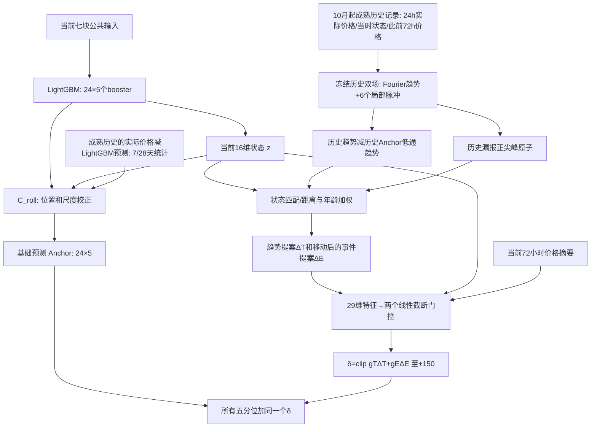

# 最新 TE_full：实际架构、数据流、训练与预测结果

核对日期：2026-10-19。模型冻结提交：`a013fd9f1f4c1c85fec3665c640195ac74bf750f`。
分支：`research/v5-conditional-event-transfer-20261017`。
本文说明已执行代码，不是下一版本设计。新增诊断、说明和CSV未改变冻结模型。

## 1. 任务与结构

每地区独立建模，当前实验 seed 2026。每小时起报一次，读取过去72小时，预测起报时刻开始的24个小时价格标签；时间均为AEST（UTC+10）。

例如2022-11-15 12:00起报，读取截至此前小时的72小时观测，预测11月15日12:00至11月16日11:00开始的24个交付小时。预测时不得读取这24小时实际价格。

结构为：冻结LightGBM → 冻结C_roll位置/尺度校正 → 历史双场的趋势/事件误差提案 → 条件采用 → 最终五分位。
它不是端到端模型；LightGBM没有位于双场后方重新学习残差。

## 2. LightGBM：全部公共输入

每个origin输入七块数据，展平为1465列。

| 数据块 | 形状 | 内容 |
|---|---|---|
| history_values | 72×2 | 电价、总需求的过去72小时观测 |
| history_calendar | 72×10 | 历史小时的小时/星期/年内日/月sin-cos、周末、标准化年份 |
| future_calendar | 24×10 | 24个目标交付小时的同类日历特征 |
| origin_context | 1 | 配置的7日燃气价格log上下文 dwgm_gas_price_7day_log |
| future_exogenous | 24×11 | 备用容量；预调度电价、需求、可用发电、净交换、覆盖标记；互联净进口、进口空间、出口空间、主进口空间、覆盖标记 |
| ctf_exogenous | 24×1 | 净负荷预测 |
| quantile_exogenous | 24×3 | 备用容量相对训练期1%、5%、10%分位阈值的shortfall特征；不是未来真实价格分位数 |

外生量按归档规则选取起报时可用的预测版本，不是读取未来实际需求或发电量。实际首次发布时间仍未完全独立审计；当前可用性验证基于已有档案代理。

公共预处理使用训练期统计。价格变换为identity，无asinh；标准化预测反变换回AUD/MWh。每地区120个boosters=24个horizon×5个分位数；训练目标为quantile pinball。同一horizon的五个分位共同选择轮数，预测后按分位轴排序。

输出 `B[t,h,q]`，形状 `[24,5]`，q为0.05、0.10、0.50、0.90、0.95。

实现：`forecasting/lightgbm/predictor.py`；公共输入：`forecasting/aligned_inputs.py`；来源：`docs/full_v5_baseline_identity.md`。

## 3. 当前状态z与C_roll

### 3.1 16维状态z（每个目标小时各一份）

1. 常数1；
2. LightGBM q50；
3. LightGBM q90−q10；
4. 预调度电价；
5. 预调度需求；
6. 预调度可用发电容量；
7. 备用容量；
8. 净负荷；
9. 进口空间；
10. 5%备用容量短缺特征；
11. 预调度覆盖标记；
12. 互联覆盖标记；
13–16. 目标小时sin/cos、周末、星期sin。

q50和区间宽度按300缩放并截断；外生量使用公共训练期标准化值，再截断至[-3,3]并除3。z是手工组装的状态向量，没有独立Transformer或深层外生编码器。

### 3.2 8维近期误差统计m

这里的残差是 `actual − LightGBM_q50`，不是 `actual − C_roll_q50`。
按同地区、同预测步长，只读已经成熟的记录：7/28天残差中位数、7/28天绝对残差中位数、28天80%/90%区间覆盖率偏差、7/28天记录数量，共8维。

### 3.3 C_roll的结构与输出

位置校正使用 `[z,m]` 24维；尺度校正用常数、基础区间宽度、备用容量、28天绝对残差统计4维。
预测步分为0–5、6–11、12–17、18–23四组，每组28参数，共112参数/地区。

`A_q = B_q50 + δ_C + s_C × (B_q − B_q50)`。

位置项有界±150；尺度因子0.5–1.5，保持分位顺序。
使用受约束线性规划拟合，加权pinball与L1惩罚；五分位权重为0.2/0.2/0.4/0.2/0.2。
当前复用7–9月拟合的C_roll。其7/28天LightGBM误差统计与下述10月起的新增双场库不是同一个历史范围。

实现：`forecasting/full_v5/calibrator.py`、`history.py`、`schema.py`。

## 4. 历史双场：重建已知过去

### 4.1 输入与时间权限

对成熟历史origin j，双场输入：

- `Y_j[24]`：j开始的24小时实际价格，完整标签已经成熟；
- `z_j[24,16]`：当时起报已知的状态，包括当时的LightGBM预测；
- `lag_j[24,3]`：j之前72小时价格重排成三天，最旧一天在前。

这些都是历史记录自己的输入。不能将当前查询未来24小时价格送入双场。

### 4.2 趋势场

基函数为常数、24小时周期的一阶cos和sin：
`T(h)=a0+a1*cos(2πh/24)+a2*sin(2πh/24)`，之后作均值保持调整。
它是低频历史曲线表达，没有直接向未来外推的步骤。

### 4.3 事件场和几何网络

先对可见历史价格拟合初始低频趋势，在剩余偏差中找最多6个局部位置，邻近一小时内作抑制。
每个位置形成27维局部上下文：3点残差、3点可见掩码、16维历史z、对应小时的三天滞后价格、位置、曲线尺度。

共享MLP为 `27 → 32 → GELU → 2`，实际代码是Linear(27,32)、GELU、Linear(32,2)，共962参数。
它预测位置偏移和宽度调整；位置相对初始锚点最多偏移0.5小时；宽度约0.25–1.5小时。
事件基函数为6个高斯脉冲，也可称零频Gabor：
`E(h)=Σ a_k*exp(-0.5*((h−μ_k)/σ_k)^2)`。

把3个Fourier基与6个脉冲合并，通过带正则的解析最小二乘求当前历史曲线的幅度系数；不是MLP直接输出未来事件幅度。
重建为 `R=T+E`，观察均值保持。事件幅度可以有正有负，但最新迁移器仅迁移正尖峰。

### 4.4 双场训练

7–8月1464条成熟训练窗口/地区，固定12epoch。训练目标是已知曲线的完整可见加权MSE，价格除300，真实价格>300的点权重4，其余权重1。
9月做重建诊断；20%遮挡是诊断方式，不是这一自适应版本的训练目标。

实现：`forecasting/full_v5/adaptive_dual_history.py`。

## 5. 历史库、趋势提案、事件提案

### 5.1 共同候选库

最新新增历史库起点固定2022-10-01，回看上限365天；并没有实际读取2021/2020同日期价格。
候选与查询同地区、同起报小时，且 `j+24h ≤ t`。少于8个候选时两项提案为0。
参数冻结，库仍随时间纳入成熟标签，这是记忆更新，不是模型重训。

### 5.2 趋势提案ΔT

每个预测步h分别匹配6个已知变量：LightGBM q50、80%宽度、预调度价格、备用容量、净负荷、进口空间。
按平均平方距离取最多16条记录，同一h对齐。
权重 `w_j ∝ exp(−distance/0.1 − age_days/28)`，归一化。

`ΔT_h = clip(Σw_j*(T_j,h − LP(A_j,q50)_h), −150,150)`。

LP仅保留DC与一阶谐波。迁移的是历史趋势相对历史C_roll预测的平滑误差，而非把历史绝对电价直接加到当前预测。

### 5.3 事件提案ΔE

每条成熟历史曲线只考虑其实际最大价格点。要求：实际峰值>300，且大于当时C_roll q50（基础模型低估）。
找距该峰值不超过2小时的最近正幅度事件原子；无有效原子则载荷为0。
原子幅度不超过历史漏报金额扣除正趋势误差后的剩余额度。

事件匹配使用9个状态：LightGBM q50、区间宽度、预调度价格/需求/可用发电、备用容量、净负荷、进口空间、5%短缺特征。
将历史峰值时的状态与当前未来24小时的已知状态逐小时比较，寻找最相近目标小时；再取最多4个历史事件。
位置移动为 `新中心=原中心+匹配目标小时−历史峰值小时`，保持幅度与宽度，不循环绕回。
按距离和年龄加权叠加并截断至[0,150]，得到ΔE。

这些都是固定匹配规则，没有另外训练一个时间对齐网络。尚未引入已确认的边际机组身份或市场情绪数据。

实现：`forecasting/full_v5/conditional_event_memory.py`。

## 6. 条件采用模块与最终预测

### 6.1 29维门控输入

| 特征组 | 维数 | 内容 |
|---|---:|---|
| 当前状态 | 16 | 上述z |
| 当前72h价格摘要 | 4 | 72h均值、标准差、最后价格、最近24h均值 |
| 修正提案 | 2 | ΔT、ΔE |
| 历史可信度和误差信息 | 7 | 趋势匹配距离、近28天actual−C_roll残差中位数、最优事件匹配距离、事件数量、事件年龄、候选池数量、事件移动量 |

这里不直接输入完整72小时序列；只给4个价格摘要。燃气和历史需求直接进入LightGBM，可能经基础预测间接影响门控，并没有在门控中另建原始特征通道。

### 6.2 结构与训练

`[gT,gE]=clip(Linear_29_to_2(features),0,1)`，共60参数/地区，24个horizon共享权重，但每小时输入不同、输出权重不同。
截断可以精确拒绝历史（0）或完全采用（1）。它不是sigmoid或深层网络。

只使用10月720个成熟窗口，固定80个Adam更新步。标签为这些窗口的实际未来24小时价格。
损失为加权五分位pinball、参数L2、采用权重惩罚；权重0.2/0.2/0.4/0.2/0.2。
只在训练目标上比较固定最后一步与零校正，不用11月选择训练轮次。

### 6.3 最终公式

`δ_H=clip(gT*ΔT+gE*ΔE,−150,150)`。
`Q_final,q=A_q+δ_H`。

新增历史修正对五分位使用相同偏移，所以不会改变Anchor已有区间宽度；C_roll的尺度调整发生在此前。
q50是点预测；模型输出电价，不输出MAE。MAE是在实际价格可用后计算的评价指标。

实现：`forecasting/full_v5/conditional_transfer_gate.py`。

## 7. 一次预测的顺序

1. 到时刻t，读取过去72小时观测、已知日历、按归档发布时间可用的外生预测。
2. LightGBM给出24×5预测B。
3. 构造z及合法成熟的7/28天LightGBM误差统计，C_roll产生Anchor A。
4. 将此时刚成熟的旧窗口编码为趋势/事件并纳入新增历史库。
5. 按当前状态检索历史，产生ΔT与ΔE；当前未来真实价格不参与。
6. 两个采用模块给出gT/gE，产生有界δ_H，叠加到A。
7. 保存24×5输出；实际价格逐步到达后评分，完整窗口成熟后才可成为后续历史。

训练和推断分开。10月Full成绩使用整月拟合后的参数回看10月，属于训练内成绩，不是当时每天已部署的前推评价。11月使用冻结的10月门控参数，历史库合法更新。

## 8. 真实预测例子

QLD1，2022-11-15 12:00 AEST起报，以下为5个交付小时。实际价格仅供事后评分。

| 交付小时AEST | LightGBM q50 | C_roll q50 | 历史修正 | Full q50 | 实际价格 |
|---|---:|---:|---:|---:|---:|
| 11-15 12:00 | 54.6829 | 55.3630 | +9.8558 | 65.2188 | 30.0767 |
| 11-15 18:00 | 197.4953 | 258.9747 | +2.1880 | 261.1627 | 466.5842 |
| 11-16 00:00 | 138.6754 | 179.2141 | +2.7779 | 181.9921 | 178.7125 |
| 11-16 06:00 | 95.0626 | 124.2389 | +11.0457 | 135.2846 | 39.4925 |
| 11-16 11:00 | 17.9445 | 9.3527 | +4.1154 | 13.4682 | 34.7208 |

其中18:00：ΔT≈−4.4858，gT≈0.9972；ΔE≈9.9650，gE≈0.6684。趋势约−4.473、事件约+6.661，合计+2.188。
最终五分位约为[202.3891,209.6990,261.1627,448.1791,610.2834]。
这是归档预测示例，不代表独立总体结果。完整24小时逐层数值位于 `logs/forecasting/v5_loss_attribution_20261019/QLD1_20221115_1200_prediction_walkthrough.csv`。

## 9. 结果与已识别问题

11月回顾性评价，三个地区seed2026、每地区696个origin：

| 模型 | NSW1 MAE | QLD1 MAE | TAS1 MAE | 宏MAE | 宏QS |
|---|---:|---:|---:|---:|---:|
| LightGBM | 33.206288 | 37.412038 | 65.566701 | 45.395009 | 30.421851 |
| C_roll | 34.132323 | 34.856338 | 66.010817 | 44.999826 | 30.961751 |
| 同Full权重仅趋势项 | 37.402378 | 42.316700 | 66.157981 | 48.625687 | 33.979623 |
| 完整TE_full | 38.003231 | 44.668246 | 67.049564 | 49.907014 | 35.239675 |

宏MAE变化：基础校正−0.395183、趋势+3.625861、事件+1.281327，总+4.512005。
训练段有收益不能证明样本外优势；趋势在三个地区的跨月评价均退化。正事件有局部尖峰收益，但普通时段代价更高。
目前没有完成跨年度同日期候选验证、没有端到端联合训练、没有运行这一版本的2023–2024最终评价。

## 10. 关键实现边界

- 所有公共输入直接进入LightGBM；历史双场和采用模块只取明确列出的子集或摘要。外生信息没有独立深层时序编码模块。
- 历史双场对成熟曲线做重建，不能将历史重建成绩作为未来预测成绩。
- 趋势仅DC+一阶谐波，事件6个局部脉冲，采用模块两个线性门控；当前结构容量确实较小。
- 历史事件迁移只针对>300且被低估的正尖峰，不涵盖负价事件，也不是可学习的因果触发器。
- 最新新增误差库仅从2022年10月开始，尚非“往年同一天+当前72h”的原始构想。
- 当前冻结清单与逐层诊断见 `logs/forecasting/v5_loss_attribution_20261019/`。
