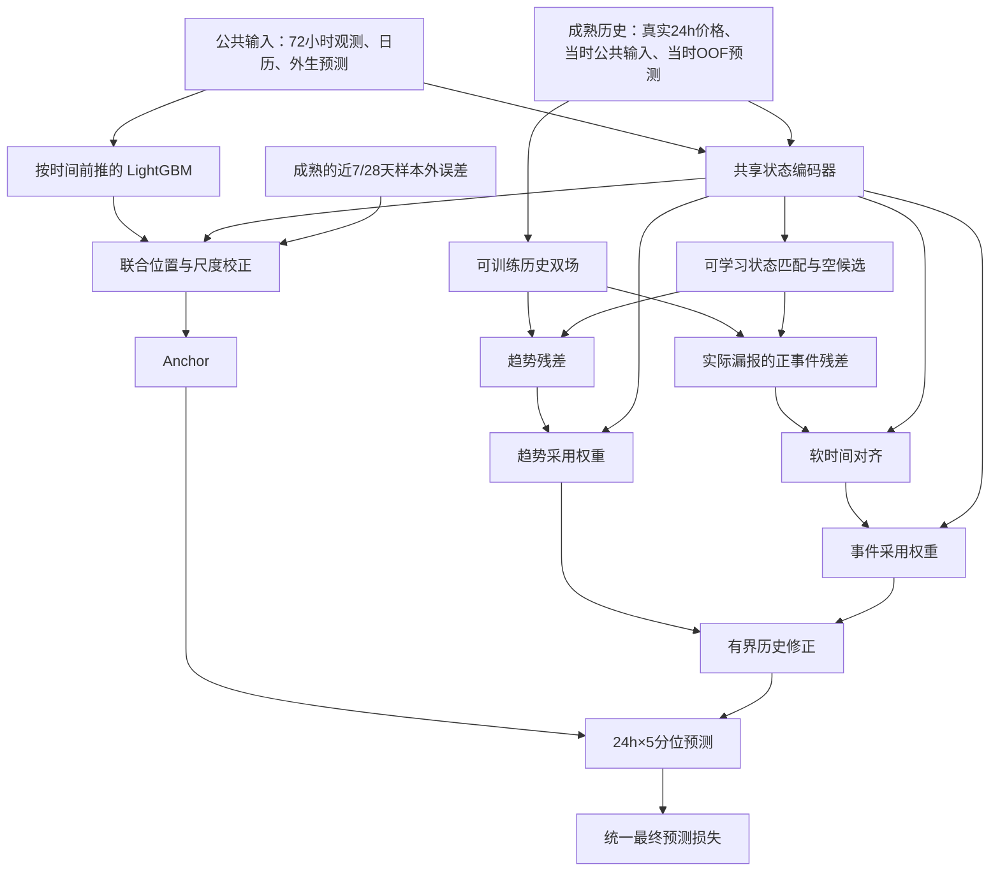

# V5 联合历史修正：实现与时间协议

分支：`research/v5-joint-history-20261019`。冻结父提交：`a013fd9`。

本轮按用户最新要求取消往年同日期检索。在原有 LightGBM → 校正 → 历史双场 → 匹配/事件对齐 → 有界修正结构上统一实现，不改写旧 V5 的代码、检查点或结果。此前年度同日分析仅保留作档案。

## 1. 统一什么

- 每小时一个预测 origin，输入过去 72 小时公共观测与当时已可用的日历、外生预测；输出未来 24 小时的五分位数：0.05/0.1/0.5/0.9/0.95。
- 同一区域所有模块最终使用统一训练段和选择段；预测阶段参数冻结，允许追加已成熟的历史记录和滚动误差统计。
- 所有可微模块由一个优化器、最终预测的平均 pinball 损失共同优化。保留小权重的历史重建辅助损失，并用同一个选择期的最终 QS 选择整体检查点。
- LightGBM 是不可微的独立训练器，**不声称梯度穿过树**。它以时间前推方式生成历史样本外预测，再让整个可微校正网络一起训练。
- 点预测始终使用 q50；MAE 与 QS 均在原始价格空间计算，QS = 2 × 五分位平均 pinball，沿用现有报告口径。

## 2. 时间协议与扩大覆盖

所有日期为 AEST（UTC+10）。一个 origin 的完整标签需到 origin+24h 才成熟。训练/选择分界处剔除跨界标签，并额外采用严格小于下一阶段起点的边界。

| 用途 | 训练数据 | 选择数据 | 产生的预测 |
|---|---|---|---|
| 历史 OOF：年份 y=2017…2021 | 2015-01-01 至 y−1 年 7 月之前 | y−1 年 7—12 月 | y 全年 |
| 历史 OOF：2022 上半年 | 2015-01-01 至 2021-07-01 之前 | 2021 下半年 | 2022 上半年 |
| 最终 LightGBM | 2015—2021 | 2022 上半年 | 2022 下半年 |
| 联合可微模块 | 2018—2021 的 OOF 样本 | 2022 上半年 OOF 样本 | 2022 下半年 |

2017 提供初始历史记忆。检索可使用最近 730 天已经成熟的记录；不要求同月同日。最终树和神经模块共同在 2022-07-01 之前完成训练与选择。树早期训练样本从 2015 开始，神经模块从 2018 开始，是因为后者需要先积累真实样本外预测和历史记忆，不能用训练内树误差填充这段空缺。

每个树折重新拟合该折训练期的公共预处理；**不能将 2015—2021 拟合出的 scaler 回用到 2017 的 OOF 预测**。每折所有数据共享该折 scaler；不同折的相对标准化状态可能存在分布变化，这是需要在多年评估中检查的实际限制。

七个树折/地区，共 21 个树训练任务；之后三个地区各训练一个联合网络。这里的任务数量是为构建无时间穿越的历史误差，不是增加 21 种最终模型。

目前协议只覆盖开发实验，2022 下半年已经被查看过，不能称为盲测。不加载 2023—2024 测试分割。

## 3. 模块与数据流



### 当前状态编码

历史块为 72×12：价格、需求、10 个日历特征。未来块为 24×31：10 个日历特征、11 个公共外生特征、1 个 CTF 特征、3 个短缺特征、1 个 origin context，以及 LightGBM 五分位预测/300。保持原有七块公共输入，没有新加入年度价格特征。

当前与历史记录共用同一编码器：按顺序展平 72 小时块并投影，未来每个 horizon 独立投影，再合并为 24 维状态。相比只用手工价格摘要，匹配与采用模块能接收完整公共输入。

### 联合校正 Anchor

`A_q = B_50 + δC + s × (B_q − B_50)`。

位置校正 `δC=150 tanh(u)`，尺度 `s=1+0.5 tanh(v)`，初始化为原始 B。输入是当前状态和成熟的近 7/28 天误差中位数、绝对误差中位数、区间覆盖偏差及样本量比例。这是重建后共同训练的校正器，不是冻结旧 C_roll 检查点。

### 历史双场与残差参照

每条候选的成熟 24 小时真实价格，加上当时的 z 状态和此前 72 小时价格，进入已有可微 Fourier+局部脉冲双场。

- 趋势场：常数项与一阶 Fourier；事件场：六个局部高斯脉冲，中心和宽度由可训练网络控制，系数用正则化线性求解得到。
- 新实例从头初始化，不加载后来月份训练的双场。每个训练 batch 内重新编码候选，保留计算图。
- 历史误差始终参考**当时生成的 OOF LightGBM**，不使用在整个训练期拟合后的联合校正器回算历史误差。
- 趋势误差：`rT = T − lowpass(B历史_50)`。
- 事件提案：`rE = min(max(E,0), max(y历史−B历史_50−max(rT,0),0))`，只迁移确实漏报的正向事件。

这是与旧版本的重要区别：若把本轮联合训练后的 Anchor 直接回算成“历史样本外误差”，该参照实际上已经看过那段训练标签。固定 OOF B 参照避免这一混淆。

### 匹配、移动与采用

先在过去 730 天、相同 origin 小时的成熟记录中取 K=16 条：一半近期记录，其余按已知 z 状态距离补齐；没有周年条件，也没有固定 28 天指数衰减。连续小时任务保留相同起始小时以对齐日内曲线。

共享状态编码后，学习趋势/事件两套匹配分数，加入历史年龄和一个零值空候选。空候选与门控可将历史贡献压到接近零；默认软门控不保证数学上的严格零，`history_off` 干预才是完全关闭。

事件采用可微时间分配矩阵，将历史事件强度分配到目标 24 小时；有时间距离偏置，不循环跨越日界。源事件总强度在移动前后保持，匹配与采用阶段可以再衰减它。事件中心候选的 top-k 选择是离散的；中心微调、宽度、系数、匹配和移动均能通过最终损失训练。

趋势分支从历史建议中扣除当前位置校正，避免两次补同一位置误差：

`ΔT = Σ wT × (rT − δC)`；`ΔE = Σ wE × Move(rE)`。

`R = 150 tanh((gT×ΔT + gE×ΔE)/150)`；`Q = A + R`。

R 对五分位作共同平移，尺度始终为正，因此不打乱分位数顺序。这一版本的历史事件主要调整位置，不能单独拓宽上尾；概率尾部宽度由 Anchor 尺度负责，是当前表达能力的边界。

### 共同训练目标

`L = mean_pinball(Q,y)/300 + 0.05 L历史重建 + 0.001 mean(g)`。

除以 300 只是共同的数值尺度，不是 asinh，也不改变 pinball 单独的最优解。辅助项用于保持双场语义，最终检查点以选择期未加辅助项的原始价格 QS 决定。所有可微参数由同一个 AdamW 更新。

## 4. 代码与运行

本地实现目录：`forecasting/full_v5_joint/`。树通过既有 `forecasting/aligned_baselines.py` 调用官方 LightGBM；双场复用本地 `forecasting/full_v5/adaptive_dual_history.py` 的可微算子。均不修改原文件。

- `protocol.py`：统一时间边界与成熟性断言。
- `prepare.py`：逐折预处理、训练树、生成 OOF 及来源哈希。
- `data.py`：OOF 来源核对、因果候选检索、滚动误差、输入/监督分离。
- `model.py`：共享状态、联合校正、双场、匹配、事件移动、门控及最终损失。
- `train.py`：整体选择与评分，正式训练必须有完整七折来源。
- `smoke.py`：基于旧存档的短窗口联调，不能作为正式 OOF 数据。

示例（仓库根目录）：

```bash
.venv/bin/python -m forecasting.full_v5_joint.prepare --region NSW1 --year 2017 --output outputs/forecasting/v5_joint_oof/NSW1/2017
# 依次为2018、2019、2020、2021、2022生成；2022普通折只预测上半年。
.venv/bin/python -m forecasting.full_v5_joint.prepare --region NSW1 --year 2022 --final-half --output outputs/forecasting/v5_joint_oof/NSW1/2022H2
.venv/bin/python -m forecasting.full_v5_joint.train --region NSW1 --bundles outputs/forecasting/v5_joint_oof/NSW1/{2017,2018,2019,2020,2021,2022,2022H2}/bundle.npz --output outputs/forecasting/v5_joint_formal/NSW1
```

QLD1、TAS1 同样运行；seed=2026。输出目录必须不存在，避免覆盖结果。保存来源哈希、训练日志、选中检查点、五组同样本预测与评分。

评估中的 `Anchor_joint`、`event_off_same_head`、`time_shift_off_same_head` 是同一检查点的关闭干预，不是单独重新训练的完整消融；也不能直接等同于旧 C_roll。

## 5. 本轮验证与状态

已运行三个地区真实数据联调：8 月1—14日训练（每6小时取一个），9月1—3日选择（每3小时取一个，边界标签剔除），9月10—12日评估（同样剔除跨界标签），3 epoch，K=8。每区52个训练 origin、16个选择 origin、16个评估 origin。具体精确行数以每区 manifest 为准。

结果在 `outputs/forecasting/v5_joint_history_20261019_smoke_r1/`；可审查的小型报告在 `logs/forecasting/v5_joint_history_20261019/report.md`。这些稀疏短窗口只能验证运行和初步贡献，不能替代多年正式比较。

还对 NSW1 的2017折运行了少量样本、两轮 boosting 的 OOF 训练链路预检，验证原始数据加载→折内预处理→树适配器→预测 bundle 可以实际衔接。预检不会被正式 OOF 加载器接受。

**完整训练与最终测试已完成**：三个地区、seed 2026 的 21 个正式树折与三个地区的 20 epoch 联合训练均完成；选择期选中的 epoch 分别为 NSW1=9、QLD1=1、TAS1=2。2022H2 是开发评估，不能替代原协议测试集。随后冻结参数，在 2023—2024 原基线测试样本上完成最终预测，每地区 17,521 个 origin；仅更新已成熟记忆与误差统计。

最终 Full_joint 宏 MAE=37.655966，原 LightGBM=37.089001，尚未超越最强基线。历史分支相对 Anchor_joint 有小幅增益。见[最终测试报告](../logs/forecasting/v5_joint_history_20261020_final_seed2026_r1/report.md)与[更新后的主基线表](../logs/forecasting/aligned_baselines_20261013_extension/README.md)。完整预测保存在 `outputs/forecasting/v5_joint_history_20261020_final_seed2026_r1/`，轻量指标、冻结哈希和各地区 manifest 已归档。

时间防线验证当前标签/未来标签不会进入预测输入，完整历史24小时均成熟后才可检索。外生发布时间仍依赖原有档案时间戳代理；本轮没有完成独立的真实发布时间审计，不能宣称所有数据源已严格无泄露。
