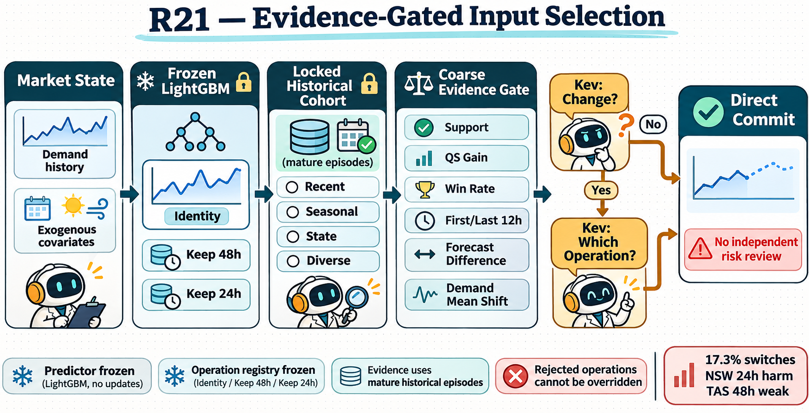
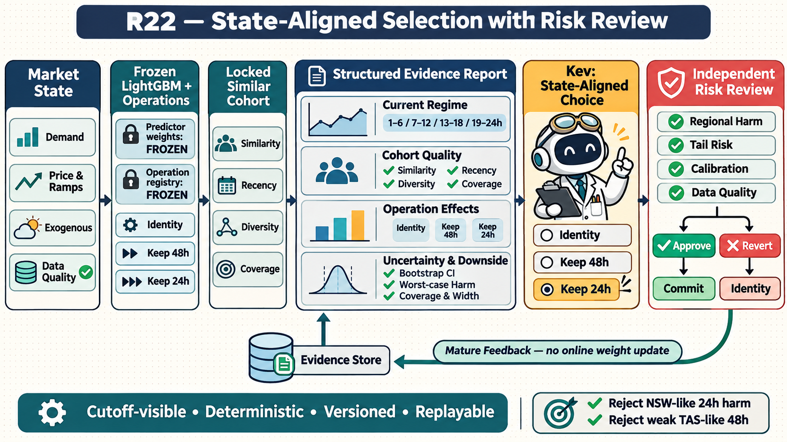

# R22 structured evidence and risk-review plan

Date: 2026-11-11

Status: R22 implementation is complete on the dedicated research branch. Unit,
regression, and live smoke validation have passed. The full 2022H2 blocked
development evaluation remains pending until the implementation commit is pushed.

## Decision

R22 keeps the frozen regional LightGBM checkpoints, canonical 1465-feature input,
registered input operations, locked mature cohort, and deterministic admission
principle from R21. It changes only the decision layer:

1. replace the coarse operation summary with a versioned structured evidence report;
2. align the candidate decision with the current observable market state;
3. add a separate risk-only review that may approve the selected candidate or revert
   to identity, but may not invent or switch to another operation;
4. fail closed to identity whenever evidence, schema, budget, or review is invalid.

The risk review is procedurally independent: it is a fresh bounded Kev call with a
separate skill and only `approve_selected` / `revert_to_identity` actions. It is not
a claim that a different model or statistically independent reviewer is used.

## Framework figures

## R21 to R22 difference

| Layer | R21 | R22 |
| --- | --- | --- |
| Predictor | One frozen LightGBM per region/seed | Unchanged |
| Operations | Identity, keep recent 48h demand, keep recent 24h demand | Unchanged and still admission-bound |
| Historical evidence | One Kev-selected mature cohort, maximum eight episodes | Same locked cohort plus explicit quality summary |
| State description | Three daily demand means and basic current disagreement | Price/demand regime, ramps, exogenous coverage, staleness, and data quality |
| Operation evidence | Support, mean/median QS gain, win rate, first/last 12h, disagreement | Four horizon buckets, uncertainty, downside, calibration, width, and similarity-weighted effects |
| Kev choice | Change or identity, then choose eligible operation | State-aligned bounded selection over identity and admitted operations |
| After selection | Direct commit | Risk-only review: approve or revert to identity |
| Failure policy | Fallback to identity | Unchanged, with explicit risk-review reasons |
| Learning | No online weight update | Unchanged; only mature evidence memory grows |

## Target control flow

1. Materialize the identity forecast from the frozen LightGBM.
2. Let Kev choose one registered retrieval strategy and lock the first mature cohort.
3. Materialize the same development-admitted input operations as R21.
4. Recompute every candidate on the same successful episode intersection.
5. Build `r22-structured-evidence-v1` deterministically.
6. Apply deterministic admission and hard safety vetoes before any nonidentity choice.
7. Kev selects identity or one evidence-admitted operation using the state-alignment skill.
8. If identity is selected, commit identity without a review call.
9. If an operation is selected, invoke the separate risk-review skill.
10. The reviewer may only approve the selected operation or revert to identity.
11. Commit atomically and record the report hash, selection, review, reasons, and costs.

R22 should retain the R21 two-stage selection trace initially for comparability, then
add Stage C for risk review. Merging Stage A and Stage B is a later cost ablation, not
part of the first R22 implementation.

## Evidence report contract

The LLM receives bounded summaries, never current/future labels, raw historical
targets, arbitrary files, or unregistered web text.

### Provenance

- schema and report version;
- context ID, region, origin, cutoff, and memory watermark;
- cohort ID, retrieval strategy, episode IDs, and warehouse fingerprint;
- predictor, operation-admission, skill, and source fingerprints;
- explicit availability and missingness for every section.

### Current regime

- latest 24h price mean, standard deviation, range, and maximum hourly ramp;
- changes against the older 48h price and standardized-demand history;
- existing registered state tags;
- cutoff-visible predispatch/PASA coverage and staleness when present;
- nonfinite, missing, duplicate, and horizon-coverage counts;
- current candidate disagreement by median, q05/q95, and interval width.

No missing source is silently imputed for the report. Missing critical fields lower
confidence or trigger identity according to a registered rule.

### Cohort quality

- common paired support and support fraction;
- similarity distance minimum, median, maximum, and dispersion;
- episode age minimum, median, maximum, and retrieval recency;
- unique state-tag count and duplicate-day protection;
- data-role composition and explicit development-overlap warning;
- cohort coverage grade: sufficient, weak, or invalid.

### Operation effects

For every nonidentity operation, report:

- mean, median, standard deviation, minimum, and maximum paired QS gain;
- win, tie, and loss counts and fractions;
- QS gain for 1-6h, 7-12h, 13-18h, and 19-24h;
- MAE, coverage90, and width90 deltas against identity;
- similarity-weighted mean QS gain and its effective support;
- agreement between unweighted and similarity-weighted gain signs;
- the operation-specific current demand-regime contrast.

The diagnostic runtime should compute these bounded aggregates before removing its
audit-only per-episode rows. Raw per-episode targets remain outside the API-visible
report.

### Uncertainty and downside

- deterministic small-sample bootstrap interval with a manifest-bound seed;
- leave-one-episode-out gain range and sign stability;
- worst paired QS loss and lower-tail mean gain;
- loss fraction and material-loss fraction;
- calibration damage and interval-width inflation summaries;
- explicit confidence grade with reasons, not an LLM-generated probability.

Bootstrap output is supporting evidence, not a significance claim with at most eight
episodes. Admission thresholds remain protocol constants frozen before replay.

## Risk-review contract

The review input contains only the selected candidate, identity, the structured
report, current forecast comparison, and deterministic veto results. It does not
contain the Stage A/B rationale.

Hard vetoes run before the reviewer and cannot be overridden:

- incomplete/nonfinite report or provenance mismatch;
- candidate not present in the admitted operation set;
- paired support below the registered minimum;
- material downside or calibration/width damage beyond frozen limits;
- current data-quality failure;
- missing operation effect or zero current forecast difference.

The reviewer then chooses exactly one action:

- `approve_selected`: commit the already selected candidate;
- `revert_to_identity`: commit identity and record one registered reason code.

Timeout, malformed output, unavailable skill, exhausted budget, or any exception
always maps to `revert_to_identity`. The reviewer cannot request new evidence,
generate a candidate, alter thresholds, or choose a different operation.

## Code-change plan

### Phase 0: freeze design and branch

- Create a dedicated research branch before any new batch experiment, as required by
  `AGENTS.md`, for example `research/r22-state-aligned-risk-review`.
- Record the R21 base commit, current operation-admission artifact, checkpoint hashes,
  and these two figure hashes.
- Freeze `r22-structured-evidence-v1`, reason codes, risk thresholds, and evaluation
  gates before producing development results.

### Phase 1: evidence primitives

- Add `forecasting/adaptive_agent/r22_evidence_report.py`.
- Keep `forecasting/adaptive_agent/decision_evidence.py` unchanged so R21 remains
  exactly replayable.
- Add pure functions for provenance, current regime, cohort quality, operation
  effects, uncertainty, and report validation.
- Extend the iterative diagnostic summary with four horizon buckets and paired risk
  aggregates; preserve raw rows only in the audit log.
- Preserve the retrieval observation in the policy so distances, ages, state tags,
  and data roles can enter the report.

### Phase 2: deterministic risk layer

- Add `forecasting/adaptive_agent/r22_risk_review.py`.
- Implement immutable hard-veto rules, registered reason codes, and fail-closed
  validation.
- Separate historical risk evidence from current forecast-shape checks.
- Return a compact review packet and a deterministic decision when a hard veto fires.

### Phase 3: R22 policy

- Add `forecasting/adaptive_agent/input_policy_r22.py`; do not overwrite the R21
  policy.
- Copy the proven locked-cohort and candidate-materialization protocol, then call the
  R22 report builder after paired diagnosis.
- Keep Stage A and Stage B bounded as in R21, but replace their observation with the
  validated report.
- Add Stage C with only approve/revert actions and a fresh risk-only request state.
- Add trace fields `evidence_report`, `evidence_report_sha256`,
  `risk_vetoes`, `stage_c_decisions`, and `final_commit_reason`.
- Reserve one additional API call only when a nonidentity candidate reaches review.

### Phase 4: skills and replay registration

- Add `forecasting/adaptive_agent/skills_r22/` with versioned selection and risk-review
  instructions, schemas, examples, and hashes.
- Register `r22_state_aligned_input` in `forecasting/adaptive_agent/replay.py`.
- Treat R22 as single-LightGBM for checkpoint loading and operator-admission checks.
- Introduce a new manifest schema binding report version, thresholds, bootstrap seed,
  skill hashes, and risk reason-code registry.
- Update replay summaries with approve/revert counts and per-reason totals.

### Phase 5: tests

- Add `tests/test_adaptive_agent_r22_evidence_report.py` for exact metrics, horizon
  buckets, similarity weighting, uncertainty, missingness, and leakage rejection.
- Add `tests/test_adaptive_agent_r22_risk_review.py` for every hard veto and fail-closed
  path.
- Add `tests/test_adaptive_agent_input_policy_r22.py` for Stage A/B/C separation,
  reviewer action bounds, timeout reversion, trace hashes, and no extra call on
  identity.
- Extend replay tests for manifest binding, resume behavior, source changes, budgets,
  and atomic commit.
- Retain and run all R21 tests unchanged to prove backward replay compatibility.

### Phase 6: development evaluation

- Do not touch the 2023-2024 test split during implementation.
- Use blocked, origin-ordered cross-validation inside the already exposed 2022H2
  development period. Threshold choice occurs only on training blocks; each held-out
  block is scored once by the frozen choice.
- Compare R22 against R21 v2 and always-identity on identical origins and candidate
  forecasts.
- Report region-equal QS, regional QS, MAE, coverage90, width90, switch rate, switch
  win rate, approve/revert rate, reason codes, latency, API calls, failures, and
  block-bootstrap intervals.
- Report targeted slices for NSW1 keep-24h and TAS1 keep-48h without presenting them
  as independent confirmatory tests.
- After cross-validated development, freeze the complete R22 artifact before any
  broader replay.

## Proposed promotion gates

The numerical values must be frozen before the first complete R22 replay. A sensible
starting gate is:

1. overall region-equal QS is better than R21 v2 on pooled held-out blocks;
2. no region degrades by more than 0.01 QS against R21 v2;
3. NSW1 keep-24h no longer has positive mean QS delta versus identity;
4. TAS1 keep-48h switching is reduced or has nonpositive mean QS delta;
5. coverage90 degradation is no worse than 0.5 percentage points in any region;
6. zero protocol errors, invalid reports, silent fallbacks, or non-atomic commits;
7. p95 origin latency and API usage remain within the frozen R22 budget.

If a gate fails, diagnose the failed report field or veto rule. Do not add operations,
unfreeze LightGBM, tune on the evaluation block, or expand Kev's action space in the
same iteration.

## Recommended implementation order

The first mergeable increment should contain only the report schema, deterministic
builders, and unit tests. The second adds hard vetoes and risk-review tests. The third
adds the R22 policy, skills, and replay registration. Only after these pass should a
new research branch run the blocked development experiment.
