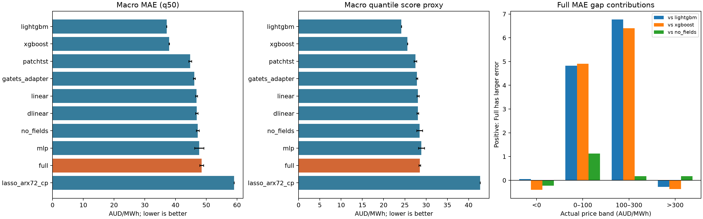

# 2026-10-12 静态共同输入基线结果

本报告只使用 aligned_baselines_20261012 的 90 格结果；全部完成并重新通过源码、配置、checkpoint、预测哈希和重评分校验。旧实验不参与本表。

## 口径

NSW1/QLD1/TAS1；seed 2026/2027/2028。每小时以 72h 历史预测未来 24h。训练 2015–2021；选择 2022H1；CP 校准 2022H2；回顾性评分 2023–2024。每地区每 seed 17,521 origins、420,504 个 origin×horizon 单元；这些单元因重叠窗口并不独立。

点预测统一为排序后的 q50，原始 AUD/MWh。QS = 五个固定分位数的平均 pinball × 2，不是精确 CRPS。先独立评分各 seed，再等权平均地区；± 为先按同一 seed 平均地区后计算的三个 seed 样本标准差，不是时间置信区间。RMSE 列是各地区/seed 的 pooled RMSE 均值，不是将三地区平方误差合并后的 RMSE。

固定配置比较；没有完成公平 HPO。Lasso-ARX72+CP 是 72h 适配版，不是原版 LEAR。其三个 seed 的预测完全相同，不提供三份独立随机证据。外生发布时间仍使用归档元数据代理。

## 主表（按宏平均 MAE 排序）

| 模型 | MAE ± seed SD | 地区平均 pooled RMSE | QS ± seed SD | 90%覆盖率 | 90%区间宽度 |
| --- | --- | --- | --- | --- | --- |
| lightgbm | 37.101 ± 0.015 | 277.064 | 24.191 ± 0.005 | 85.10% | 141.35 |
| xgboost | 37.930 ± 0.074 | 277.594 | 25.622 ± 0.019 | 85.02% | 165.55 |
| patchtst | 44.764 ± 0.456 | 272.834 | 27.483 ± 0.315 | 86.12% | 145.08 |
| gatets_adapter | 46.096 ± 0.326 | 273.100 | 27.842 ± 0.191 | 83.94% | 141.13 |
| linear | 46.823 ± 0.310 | 272.453 | 28.090 ± 0.269 | 85.88% | 150.93 |
| dlinear | 46.898 ± 0.397 | 272.209 | 28.045 ± 0.199 | 86.42% | 152.99 |
| no_fields | 47.224 ± 0.503 | 268.460 | 28.488 ± 0.678 | 84.48% | 173.16 |
| mlp | 47.705 ± 1.484 | 276.738 | 28.884 ± 0.719 | 81.94% | 145.84 |
| full | 48.464 ± 0.645 | 271.053 | 28.506 ± 0.211 | 85.13% | 176.62 |
| lasso_arx72_cp | 59.051 ± 0.000 | 288.006 | 42.702 ± 0.000 | 98.46% | 419.17 |

## 地区 MAE（每地区三个 seed）

| 模型 | NSW1 | QLD1 | TAS1 |
| --- | --- | --- | --- |
| lightgbm | 44.333 ± 0.027 | 38.213 ± 0.022 | 28.758 ± 0.049 |
| xgboost | 45.209 ± 0.076 | 39.475 ± 0.097 | 29.107 ± 0.057 |
| patchtst | 54.290 ± 0.742 | 47.486 ± 0.523 | 32.515 ± 0.139 |
| gatets_adapter | 53.718 ± 0.628 | 49.679 ± 0.386 | 34.892 ± 0.036 |
| linear | 56.710 ± 0.493 | 49.759 ± 0.578 | 34.000 ± 0.074 |
| dlinear | 56.570 ± 0.460 | 50.175 ± 0.995 | 33.948 ± 0.101 |
| no_fields | 58.770 ± 1.290 | 48.945 ± 0.558 | 33.956 ± 1.101 |
| mlp | 56.585 ± 0.727 | 52.600 ± 2.914 | 33.931 ± 1.172 |
| full | 58.834 ± 0.257 | 52.666 ± 2.656 | 33.893 ± 0.847 |
| lasso_arx72_cp | 70.847 ± 0.000 | 71.730 ± 0.000 | 34.576 ± 0.000 |

## Full 的误差来源

以下是按实际价格事后切片的误差分解，不是输入或模块的因果贡献；正值表示 Full 更差。各价格区间贡献之和精确等于总体 MAE 差。

| 参照 | negative | 0_to_100 | 100_to_300 | spike | 合计 |
| --- | --- | --- | --- | --- | --- |
| lightgbm | +0.051 | +4.826 | +6.767 | -0.281 | +11.363 |
| xgboost | -0.403 | +4.904 | +6.406 | -0.373 | +10.534 |
| no_fields | -0.233 | +1.124 | +0.174 | +0.176 | +1.241 |

## 尖峰切片（实际价格 >300）

各地区先平均 seed 的切片损失，再等权平均地区。q95 在真实尖峰上的损失仅描述该切片；不是全分布校准或尖峰发生概率检验，不能忽略非尖峰误报。独立交付小时数另存 per-seed 切片 CSV。

| 模型 | 尖峰 q50 MAE | 尖峰 q95 pinball |
| --- | --- | --- |
| lightgbm | 988.399 | 655.827 |
| xgboost | 993.813 | 672.165 |
| patchtst | 961.069 | 688.815 |
| gatets_adapter | 977.003 | 674.551 |
| linear | 958.248 | 672.556 |
| dlinear | 956.839 | 668.037 |
| no_fields | 961.922 | 642.655 |
| mlp | 997.492 | 690.668 |
| full | 973.295 | 627.550 |
| lasso_arx72_cp | 1070.787 | 827.658 |

## 配对统计（探索性）

配对非循环 moving-block bootstrap，9,999 次，主块长 168h、24h 敏感性。沿完整 origin 时间轴抽样，三个地区使用同样块起点，先平均 seed 损失而非预测；尾部按重采样损失总和/事件数计算，保留无事件 origin。

比较族：Full 与其他九模型的 MAE/QS；Full 与 LightGBM/XGBoost/no_fields 的负价 q05、尖峰 q95；LightGBM 与 XGBoost 的 MAE/QS。每个块长内对全部 104 个地区/宏平均检验统一 Holm 修正。95% CI 是未作多重比较校正的百分位区间，显著性仅看 Holm p；24h 是敏感性分析，不从两个块长择优。

这些比较及切片在已查看部分结果后制定，属于探索性统计。区间仅反映给定已训练模型的时间样本不确定性；三个 seed 不充分刻画训练随机性。不包含 DM/GW 检验，不宣称完整 SOTA 统计协议已执行。

| 比较 | 指标 | 差值 | 168h 95% CI | Holm p | 24h Holm p |
| --- | --- | --- | --- | --- | --- |
| full_minus_lightgbm | mae | +11.363 | [+10.074, +12.854] | 0.0104 | 0.0104 |
| full_minus_lightgbm | crps_quantile_approx | +4.314 | [+3.800, +4.917] | 0.0104 | 0.0104 |
| full_minus_xgboost | mae | +10.534 | [+9.276, +12.008] | 0.0104 | 0.0104 |
| full_minus_xgboost | crps_quantile_approx | +2.884 | [+2.396, +3.474] | 0.0104 | 0.0104 |
| full_minus_patchtst | mae | +3.701 | [+2.869, +4.653] | 0.0104 | 0.0104 |
| full_minus_patchtst | crps_quantile_approx | +1.022 | [+0.577, +1.457] | 0.0104 | 0.0104 |
| full_minus_gatets_adapter | mae | +2.368 | [+1.414, +3.460] | 0.0118 | 0.0104 |
| full_minus_gatets_adapter | crps_quantile_approx | +0.664 | [+0.154, +1.237] | 0.6760 | 0.0533 |
| full_minus_linear | mae | +1.641 | [+0.862, +2.294] | 0.0168 | 0.0104 |
| full_minus_linear | crps_quantile_approx | +0.416 | [-0.104, +0.850] | 1.0000 | 1.0000 |
| full_minus_dlinear | mae | +1.567 | [+0.788, +2.212] | 0.0168 | 0.0104 |
| full_minus_dlinear | crps_quantile_approx | +0.461 | [-0.063, +0.906] | 1.0000 | 0.7440 |
| full_minus_no_fields | mae | +1.241 | [+0.902, +1.604] | 0.0104 | 0.0104 |
| full_minus_no_fields | crps_quantile_approx | +0.018 | [-0.153, +0.207] | 1.0000 | 1.0000 |
| full_minus_mlp | mae | +0.759 | [-0.154, +1.779] | 1.0000 | 0.5088 |
| full_minus_mlp | crps_quantile_approx | -0.378 | [-0.747, +0.008] | 1.0000 | 1.0000 |
| full_minus_lasso_arx72_cp | mae | -10.587 | [-12.323, -8.871] | 0.0104 | 0.0104 |
| full_minus_lasso_arx72_cp | crps_quantile_approx | -14.197 | [-15.419, -13.160] | 0.0104 | 0.0104 |
| full_minus_lightgbm_tail | pinball_q05_negative_hours | -1.148 | [-1.811, -0.472] | 0.0357 | 0.0104 |
| full_minus_lightgbm_tail | pinball_q95_spike_hours | -28.277 | [-72.100, +3.998] | 1.0000 | 1.0000 |
| full_minus_xgboost_tail | pinball_q05_negative_hours | -3.830 | [-4.453, -3.141] | 0.0104 | 0.0104 |
| full_minus_xgboost_tail | pinball_q95_spike_hours | -44.615 | [-92.066, -7.302] | 1.0000 | 0.3115 |
| full_minus_no_fields_tail | pinball_q05_negative_hours | +0.016 | [-0.339, +0.445] | 1.0000 | 1.0000 |
| full_minus_no_fields_tail | pinball_q95_spike_hours | -15.105 | [-26.400, -6.132] | 0.3174 | 0.0104 |
| lightgbm_minus_xgboost | mae | -0.829 | [-0.959, -0.698] | 0.0104 | 0.0104 |
| lightgbm_minus_xgboost | crps_quantile_approx | -1.431 | [-1.614, -1.233] | 0.0104 | 0.0104 |

## 训练与诊断附件

NSW1 Full 的三个 seed 都在第一轮达到所选最佳 checkpoint；这提示优化/目标/验证期适应问题，但不证明过拟合的唯一原因。no_fields 关闭双场对预测的贡献，仍执行双场拟合及重构损失；它不是删掉全部双场计算的等成本对照。

crossing_rate 在共同评分排序前计算，但 Full/no_fields 的 forward 已内部排序，零值不证明未排序专家从不交叉。各模型完整数据在 CSV 中保留，不把该列当独立架构排名。

| 模型 | 累计 worker 小时 | 最少不同 seed 预测数 |
| --- | --- | --- |
| lightgbm | 14.36 | 3 |
| xgboost | 1.38 | 3 |
| patchtst | 0.38 | 3 |
| gatets_adapter | 0.94 | 3 |
| linear | 0.06 | 3 |
| dlinear | 0.08 | 3 |
| no_fields | 0.47 | 3 |
| mlp | 0.06 | 3 |
| full | 0.36 | 3 |
| lasso_arx72_cp | 2.16 | 1 |

worker 时间含载入、训练、预测和保存；GPU/CPU 实现不同，不能用该列直接证明算法效率优劣。



文件：main.csv / regional.csv / per_seed.csv / price_bands_per_seed.csv / price_bands_macro.csv / temporal_per_seed.csv / gap_contributions.csv / training.csv / comparisons.csv / comparisons.json / verified_report.json.gz / provenance.json。

复现命令：

```bash
.venv/bin/python -m forecasting.analysis.aligned_results \
  --run-root outputs/forecasting/aligned_baselines_20261012 \
  --output logs/forecasting/aligned_baselines_20261012/results
```
