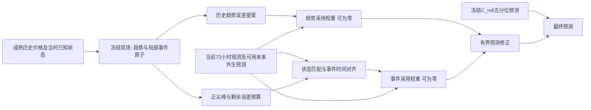

# 条件历史事件迁移：实现与验证结果

原版本已以作者 zl 提交为 `c9074c9`，新分支为 `research/v5-conditional-event-transfer-20261017`。本轮只新增模块、配置、测试和报告，冻结原 LightGBM、C_roll 与上一轮历史双场编码器；未推送。

## 用户假说与本轮实现

“当前状态相近时平滑趋势可参考历史，当前市场证据支持事件时将历史尖峰移动过来”是可以检验的预测假说，但不能预设成立。没有观测到外因，不等于不存在未观测冲击；状态相似也不等于事件成因相同。

这轮实现了完整的数据路径：

趋势提案来自历史双场趋势相对于当时基线低通预测的误差；事件提案只来自已成熟、真实 >300 且基线低估的历史窗口。历史局部高斯原子的中心按当前 24 小时已知状态平移，振幅受到剩余历史误差预算限制，不把过去的绝对高价直接叠到当前价格上。

两个 29 维线性采用模块分别控制趋势和事件，共 60 个参数，可精确归零。事件原子迁移后保持幅度与宽度；同一批候选的“不移动”对照只恢复原中心，防止混淆选择历史与移动历史的贡献。最终仍是五分位同量、最大 ±150 的修正，q50 评分规则未变。

可用输入包含预调度价格/需求、可用发电容量、备用裕度、净负荷、进口空间等，**没有已确认的边际机组身份或新市场情绪数据**。这轮是代理状态条件迁移，不是识别边际发电因果机制。

## 时间与比较口径

三地区 NSW1/QLD1/TAS1、seed 2026。沿用 7–8 月训练好的双场，所有采用模块固定训练 80 步，仅使用十月、且完整标签在十一月前成熟的 720 个起报窗口。近期误差和上一版全局修正的四个系数也只用十月重新拟合。

评分为十一月同一批 696 个起报窗口，标签完整可用时间严格早于十二月。十一月也是已被查看的回顾性开发月份，不是新盲测；本轮没有评分十二月或最终 2023–2024 测试。**以下分数不能直接与上一轮十二月分数比较。**

当前样本外误差库只从十月开始，训练采用规则也只有一个月；这尚不是“去年、前年同日”的完整跨年度验证。历史候选中的一条曲线只能在其 24 小时标签完整成熟后使用，每个查询的同起报小时历史窗口按天不重叠。

## 完整结果

| 模型 | NSW1 MAE | QLD1 MAE | TAS1 MAE | 宏 MAE | 宏 QS |
|---|---:|---:|---:|---:|---:|
| LightGBM | 33.2063 | 37.4120 | 65.5667 | 45.3950 | 30.4219 |
| C_roll | 34.1323 | 34.8563 | 66.0108 | **44.9998** | 30.9618 |
| 近期误差对照 | 41.2540 | 46.9579 | 66.9935 | 51.7351 | 36.7982 |
| 上一版全局系数双场 | 48.5187 | 56.1730 | 68.3813 | 57.6910 | 42.1655 |
| 仅趋势修正项、另拟合采用模块 | 37.5699 | 43.6707 | 66.2070 | 49.1492 | 34.5035 |
| 不移动事件、另拟合采用模块 | 39.8575 | 44.5424 | 66.1814 | 50.1938 | 35.5609 |
| 完整条件迁移 | 38.0032 | 44.6682 | 67.0496 | 49.9070 | 35.2397 |
| 固定脉冲条件迁移 | 37.9120 | 45.2179 | 66.2210 | 49.7836 | 35.1577 |
| 完整模型同权重关闭事件 | 37.4024 | 42.3167 | 66.1580 | 48.6257 | 33.9796 |
| 完整模型同权重取消时间移动 | 38.3338 | 44.0617 | 66.7605 | 49.7186 | 35.1297 |

完整方案比旧全局修正改善，但没有优于 C_roll、LightGBM 或固定脉冲。这里还改变了历史提案，不能将相对旧全局修正的全部收益归于采用模块。“仅趋势修正项”仍接收事件相关特征，不能称为移除全部事件信息的消融。

## 是否真的采用了历史尖峰

采用模块确实会拒绝历史事件，也确实在部分预测中使用了事件：

| 地区 | 事件采用权重精确为零 | 事件实际改变预测 | 事件平均绝对贡献 AUD/MWh |
|---|---:|---:|---:|
| NSW1 | 76.18% | 19.55% | 1.028 |
| QLD1 | 66.68% | 30.33% | 5.122 |
| TAS1 | 60.98% | 20.88% | 1.496 |

非零权重与实际贡献不同：有权重也可能没有有效事件原子，或被最终限幅影响。以上贡献由完整模型减去同一权重关闭事件后的预测测得。

但事件净贡献为**宏 MAE 增加 1.2813**。普通价格成本贡献 +1.4461，负价成本 +0.0079，正尖峰收益 −0.1727，收益不足以抵消普通时段的代价。

QLD1 的 q50>300 召回从 C_roll 的 3.35% 提高到 20.10%，误报却从 21 增到 268 个预测单元。真实独立尖峰小时仅 NSW1 4 个、QLD1 18 个、TAS1 6 个；重叠预测单元不是独立事件数量。现有采用规则没有充分区分事件与普通状态。

## 时间移动本身有没有贡献

固定完整模型的参数、输入特征、历史候选、幅度及宽度，只关闭时间移动：

| 地区 | 移动相对不移动的总 MAE 变化 | 尖峰条件 MAE 变化 |
|---|---:|---:|
| NSW1 | −0.3306 | +4.9383 |
| QLD1 | +0.6066 | +11.7092 |
| TAS1 | +0.2891 | +0.1134 |

宏平均总 MAE 增加 0.1884；三个地区尖峰条件误差都增加。因此，**本轮没有验证“按当前代理状态搬移历史尖峰”有效**。完整模型优于“单独重新拟合的不移动模型”，不能推导出移动有益，因为重新拟合改变了采用规则。

## 对想法的判断与后续重点

这不是对整个历史类比思路的否定，而是对当前具体实现的否定证据：有限代理状态的最近匹配，加一个月训练的线性采用规则，尚不足以决定当前是否应出现那个历史事件。

更关键的下一步是先验证**事件触发证据是否有区分力**，再判断时间对齐能否改善，而不是继续增加历史曲线拟合精度。现有事件库较短、采用模块只见到一个月，不能据此判断跨年度历史的可迁移性。若扩展，应先构造跨季节的严格样本外误差历史，再用前推开发折检验；不能使用主模型训练内误差假装未来可迁移误差。

由于五个分位数仍同量平移，弱事件风险证据也可能抬高普通时段的中位数。上尾风险与 q50 点预测应分别诊断；如改变分位数修正形式，须另开预先声明的实验，不能在此次结果上偷偷改评分或选择版本。本轮不据十一月分数重调参数，也不自动开展十二月评分。

## 验证与保存

37 项相关测试通过。独立验收核对 27 个源码/快照、3 个冻结编码器、12 个采用模块检查点、30 份重评分预测、24 份精确预测重放、9 份事件形状重放，以及 35,988 次事件引用和 4,126,464 次趋势引用，成熟时间违规为零。

时序结论仍依赖既有外生归档时间代理，不代表全部真实首次发布时间已获独立认证。

完整逐地区指标、固定头贡献与验收在本目录 JSON；模型参数、候选、事件中心/宽度/幅度、采用权重和预测保存在 `outputs/forecasting/v5_conditional_event_transfer_20261017_r1`。方案与默认配置在 `docs/full_v5_conditional_event_transfer_20261017.md`、`configs/full_v5/conditional_event_transfer.yaml`。
